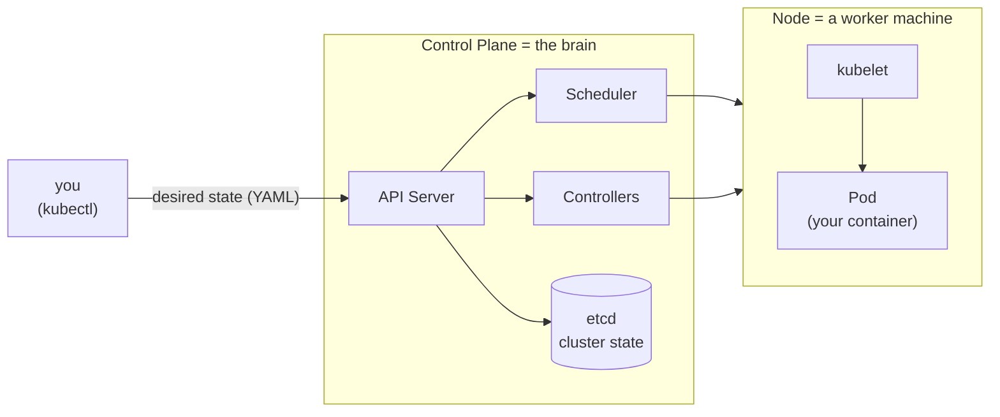

# Module 0 — Setup

## 🎯 What you'll learn

- Get a working single-node Kubernetes cluster running locally on Windows.
- Understand what `kubectl` is and how it finds your cluster (contexts).
- Verify the cluster is healthy and run your very first pod.
- Know how to switch between the clusters you have installed.

## 🐳 Docker bridge

You already run containers with `docker run`. Kubernetes is the layer **above**
that: instead of you starting containers by hand, you tell a **cluster** the
state you want ("run 3 copies of this image") and it makes that true and keeps
it true. `docker` talks to one Docker engine; `kubectl` talks to a cluster's
**API server**.

## 🧠 Concept

A **cluster** is a control plane (the brain — API server, scheduler,
controllers) plus one or more **nodes** (machines that actually run your
containers). Locally, a single program fakes all of this on your laptop.

You have three local options already installed:

| Tool | What it is | Best for |
|------|-----------|----------|
| **Docker Desktop K8s** | Single-node cluster baked into Docker Desktop | Simplest, already wired to your `docker-desktop` context |
| **kind** | "Kubernetes IN Docker" — clusters as containers | Fast, disposable, supports multi-node (great later) |
| **minikube** | Single-node cluster in a container/VM | Batteries-included addons (dashboard, ingress) |

`kubectl` doesn't care which you pick — it reads a **context** (cluster address
+ credentials) from `~/.kube/config` and talks to whatever is "current".

> **Recommendation for this course:** **kind**. It starts in ~30s, needs no GUI
> toggle (just a running Docker), is trivially disposable (`kind delete cluster`),
> and lets us do multi-node scheduling exercises later. Docker Desktop K8s is a
> fine alternative if you'd rather flip its switch.

## 📊 Diagram



`kubectl` only ever talks to the API Server. Everything else reacts to keep
**actual state** matching **desired state**. That reconcile loop is the whole
idea of Kubernetes — we go deep on it in Module 1.

## 📋 Cheatsheet

```bash
# --- contexts: which cluster am I talking to? ---
kubectl config get-contexts          # list all clusters you can reach
kubectl config current-context       # which one is active
kubectl config use-context kind-k8s-course   # switch active cluster

# --- option A: kind (recommended) ---
kind create cluster --name k8s-course   # create; sets context kind-k8s-course
kind get clusters                       # list kind clusters
kind delete cluster --name k8s-course   # tear it down

# --- option B: Docker Desktop K8s ---
# Docker Desktop > Settings > Kubernetes > Enable Kubernetes > Apply & restart
kubectl config use-context docker-desktop

# --- option C: minikube ---
minikube start
minikube stop

# --- verify any cluster ---
kubectl cluster-info                 # control-plane URL
kubectl get nodes                    # nodes should be STATUS=Ready
kubectl get pods -A                  # -A = all namespaces (system pods)

# --- first pod ---
kubectl run hello --image=nginx --restart=Never
kubectl get pods
kubectl delete pod hello
```

## 🧪 Practice

> Pick **one** cluster. I recommend kind. Do these on your machine and paste
> the output back to me as you go.

**Step 1 — Bring a cluster online.**

Using kind (recommended):
```bash
kind create cluster --name k8s-course
```
Or use Docker Desktop: enable Kubernetes in Settings, then
`kubectl config use-context docker-desktop`.

**Step 2 — Confirm kubectl is pointed at it.**
```bash
kubectl config current-context
```

**Step 3 — Check the node is Ready.**
```bash
kubectl get nodes
```
You want `STATUS = Ready`.

**Step 4 — Peek at the system pods (the control plane doing its job).**
```bash
kubectl get pods -A
```

**Step 5 — Run your first pod, then clean up.**
```bash
kubectl run hello --image=nginx --restart=Never
kubectl get pods
kubectl delete pod hello
```

## ✅ Check yourself

You should now be able to:

- [ ] Get `kubectl get nodes` to show a `Ready` node.
- [ ] Say which context you're using and switch to another.
- [ ] Create and delete a pod.

**Challenge:** Without looking at the cheatsheet, switch to a *different*
context, run `kubectl get nodes`, then switch back to your course cluster.

## 🐛 Common gotchas

- **`dial tcp 127.0.0.1:6443: connection refused`** → your selected context's
  cluster isn't running. Start it (kind/minikube) or enable Docker Desktop K8s,
  or `use-context` a cluster that *is* up. (You hit exactly this on
  `docker-desktop` — its K8s engine was off.)
- **Wrong context** → commands "work" but hit the wrong cluster (e.g. your AKS
  cluster instead of local). Always check `current-context` first.
- **kind needs Docker running** → if Docker Desktop is closed, `kind create`
  fails. Docker engine must be up.
- **Pod stuck `ContainerCreating`** → usually it's pulling the image; give it a
  few seconds and re-run `kubectl get pods`.
