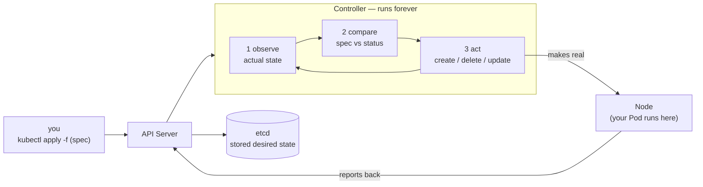

# Module 1 — Mental model

## 🎯 What you'll learn

- The one idea that *is* Kubernetes: the **reconcile loop** — controllers
  continuously drive **actual state → desired state**.
- The difference between **imperative** (`kubectl run`) and **declarative**
  (`kubectl apply -f`) — and why real work is declarative.
- How to read any object as **`spec`** (what you want) vs **`status`** (what is).
- The core control-plane parts and the rule that *everything* talks only to the
  API server.
- How to explore the cluster's API surface with `kubectl api-resources` and
  `kubectl explain`.

## 🐳 Docker bridge

With Docker you give **commands**: `docker run nginx` starts *one* container,
*right now*. If it dies, it stays dead until you run it again. Docker does
exactly what you say, once.

Kubernetes flips this. You don't give commands — you declare a **desired
state** ("there should be an nginx pod named `mental-model`") and hand it to the
cluster. A **controller** then works forever to make reality match, and to keep
it matching. Docker has no equivalent of that always-on "make it so" loop.

| | Docker | Kubernetes |
|---|--------|-----------|
| Style | Imperative ("do this now") | Declarative ("this should be true") |
| Unit | one container | desired state of objects |
| If it dies | stays dead | controller notices & reconciles |
| You talk to | one Docker engine | the cluster's **API server** |

## 🧠 Concept

Every Kubernetes object is a little contract with two halves:

- **`spec`** — *desired state*. What **you** declare you want.
- **`status`** — *actual state*. What the cluster currently observes.

A **controller** is a loop that does three things, over and over, forever:

1. **Observe** current state (read `status` / the real world).
2. **Compare** it to `spec`.
3. **Act** to close the gap (create/delete/update things), then update `status`.

This is the **reconcile loop**, and it is the entire philosophy of Kubernetes.
"Self-healing", "rollouts", "autoscaling" — they're all just controllers
reconciling `spec` and `status`. Once this clicks, the rest of the course is
learning *which* objects and *which* controllers solve *which* problems.

**Imperative vs declarative.** In Module 0 you ran `kubectl run hello ...` —
that's imperative (fire one command). From here on we mostly write YAML and
`kubectl apply -f` it — that's declarative. The win: the YAML is a checked-in,
repeatable source of truth, and re-applying it is safe (it just reconciles to
the same desired state).

> ⚠️ A **bare Pod** (like the one in this lab) has *no controller above it*.
> Nothing is loop-watching to recreate it. Delete it and it's gone for good.
> That's exactly why, in real life, you almost never create Pods directly —
> you create a **Deployment** (Module 3) whose controller keeps Pods alive.

## 📊 Diagram



The loop never stops. Drift in (a pod dies, you change the spec) → the
controller notices on its next pass → it acts → reality converges again.

## 📋 Cheatsheet

```bash
# --- declarative (the daily driver from here on) ---
kubectl apply -f file.yaml        # create OR update to match desired state
kubectl delete -f file.yaml       # remove what that file declares

# --- imperative (quick & dirty, Module 0 style) ---
kubectl run NAME --image=IMG --restart=Never

# --- read spec (desired) vs status (actual) ---
kubectl get pod NAME -o yaml      # full object: see spec: and status:
kubectl get pod NAME -o jsonpath='{.spec.containers[0].image}{"\n"}'   # desired image
kubectl get pod NAME -o jsonpath='{.status.phase}{"\n"}'               # actual phase

# --- explore the API surface ---
kubectl api-resources             # every kind you can create (+ short names)
kubectl explain pod               # docs for a kind
kubectl explain pod.spec.containers   # drill into any field
```

## 🧪 Practice

> Run these on `kind-k8s-course` and paste the output back to me as you go.
> First confirm your context: `kubectl config current-context`.

**Step 1 — Declare a pod (declarative).**
```bash
kubectl apply -f manifests/01-mental-model/pod.yaml
```
Expected: `pod/mental-model created`. Notice you described *what you want* in a
file, not a one-off command.

**Step 2 — Read the DESIRED state (`spec`).**
```bash
kubectl get pod mental-model -o jsonpath='{.spec.containers[0].image}{"\n"}'
```
Expected: `nginx`. This is what you asked for.

**Step 3 — Read the ACTUAL state (`status`).**
```bash
kubectl get pod mental-model -o jsonpath='{.status.phase}{"\n"}'
```
Expected: `Running` (give it a few seconds if it's still `Pending` while the
image pulls). This is what the cluster made true.

**Step 4 — See both halves together.**
```bash
kubectl get pod mental-model -o yaml
```
Scroll to find the `spec:` block (what you declared) and the `status:` block
(what the controller filled in: phase, IP, conditions, start time).

**Step 5 — Explore the API.**
```bash
kubectl api-resources | findstr /I "deployments services pods"
kubectl explain pod.spec.containers | more
```
You're seeing the menu of kinds you can declare, and the field docs for one.

**Step 6 — Watch "no controller" in action, then clean up.**
```bash
kubectl delete pod mental-model
kubectl get pods
```
The pod is gone and **nothing brings it back** — a bare Pod has no controller
watching it. (Hold that thought for Module 3, where a Deployment *will*.)

## ✅ Check yourself

You should now be able to:

- [ ] Explain the reconcile loop in one sentence (observe → compare → act, forever).
- [ ] Point at `spec.containers[0].image` and call it *desired*, and
      `status.phase` and call it *actual*.
- [ ] Say why `apply` is declarative and `run` is imperative.
- [ ] Explain why the deleted bare Pod did **not** come back.

**Challenge:** Re-apply the pod with `kubectl apply -f manifests/01-mental-model/pod.yaml`
**twice** in a row. What does the second apply say, and *why* is running it again
harmless? (Hint: think desired state, not "create".)

## 🐛 Common gotchas

- **`kubectl edit` changes that "vanish"** — if you hand-edit a field that a
  controller owns, the controller reconciles it right back. Change the `spec`
  source (the YAML), not the live object.
- **Imperative drift** — mixing ad-hoc `kubectl run/create/set` with checked-in
  YAML means your cluster no longer matches your files. Prefer `apply -f`.
- **Bare Pods don't self-heal** — no controller = no recreation when it dies or
  its node fails. Almost always use a Deployment instead.
- **`Pending` for a while** — `status.phase` can sit at `Pending` while the
  image pulls or while the scheduler places it; that's normal, re-check.
