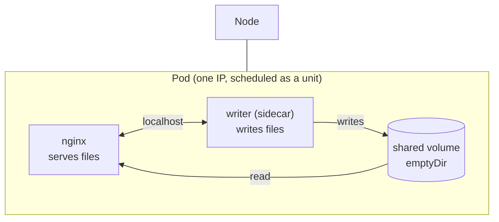

# Module 2 — Pods

## 🎯 What you'll learn

- What a **Pod** actually is: the smallest deployable unit in Kubernetes —
  one *or more* containers that share a network and storage.
- Why containers in a Pod can reach each other on **`localhost`** and share
  files through a **shared volume** (the sidecar pattern).
- Why you almost never create bare Pods directly in real life.
- The **lifecycle phases** a Pod moves through, and what `restartPolicy` does.
- How to read **logs** and **exec** into a *specific* container with `-c`.

## 🐳 Docker bridge

In Docker, the unit is **one container**. To make two containers share a
network you'd do something awkward like `docker run --network container:other`,
and to share files you'd hand-wire a volume into both.

A **Pod** bakes that in: the containers inside a Pod automatically share **one
network namespace** (same IP, they talk over `localhost`) and can share
**volumes**. Think of a Pod as "a little group of containers that are always
scheduled together, on the same node, as one unit." Most Pods have exactly one
container — but the *option* of more is what makes the sidecar pattern possible.

| | Docker | Kubernetes Pod |
|---|--------|---------------|
| Unit | 1 container | 1+ containers scheduled together |
| Network | each container its own | all containers share one IP + `localhost` |
| Volumes | per-container, hand-wired | declared once, mounted into any container |
| Scheduling | independent | the whole Pod lands on one node together |

## 🧠 Concept

A **Pod** is the atom of Kubernetes — the smallest thing you can ask the cluster
to run. Key facts:

- **Shared network.** Every container in the Pod shares the Pod's IP. They reach
  each other on `localhost:<port>`. (Two containers can't both use the same
  port, though.)
- **Shared storage.** Volumes are declared on the Pod and mounted into whichever
  containers need them — that's how containers in a Pod swap files.
- **All-or-nothing placement.** The whole Pod is scheduled onto **one node**.
  You can't have half a Pod on node A and half on node B.

**The sidecar pattern.** A common real use of multi-container Pods: a main
container plus a helper ("sidecar") that does logging, syncing, or serving
shared files. In this lab, a busybox sidecar *writes* files into a shared volume
and nginx *serves* them.

**Why you rarely create bare Pods.** A Pod by itself has **no controller**
(remember Module 1's reconcile loop). If it dies, or its node fails, nothing
recreates it. In real work you create a **Deployment** (Module 3) whose
controller keeps the right number of Pods alive. Today we use bare Pods *only*
to study the atom directly.

**Lifecycle phases** (`status.phase`):

| Phase | Meaning |
|-------|---------|
| `Pending` | accepted, but not all containers running yet (e.g. pulling image) |
| `Running` | bound to a node, at least one container running |
| `Succeeded` | all containers exited 0 and won't restart |
| `Failed` | all containers terminated, at least one failed |

`restartPolicy` (`Always` default for Deployments / `OnFailure` / `Never`)
controls whether the kubelet restarts a container *inside* the Pod when it exits.

## 📊 Diagram



Both containers see the same volume and can talk over `localhost` — because
they live in the same Pod.

## 📋 Cheatsheet

```bash
# --- create / inspect pods ---
kubectl apply -f pod.yaml
kubectl get pods                      # list
kubectl get pod NAME -o wide          # + node and Pod IP
kubectl describe pod NAME             # events, container states, why it's stuck

# --- logs ---
kubectl logs NAME                     # single-container pod
kubectl logs NAME -c CONTAINER        # pick a container in a multi-container pod
kubectl logs NAME --previous          # logs from the PREVIOUS (crashed) instance

# --- exec (run a command inside a container) ---
kubectl exec -it NAME -- sh                       # shell into the (first) container
kubectl exec NAME -c CONTAINER -- cat /path       # run in a specific container

# --- cleanup ---
kubectl delete pod NAME
kubectl delete -f pod.yaml
```

## 🧪 Practice

> Run on `kind-k8s-course`; paste output as you go.

**Step 1 — A single-container Pod.**
```bash
kubectl apply -f manifests/02-pods/pod.yaml
kubectl get pod web -o wide
```
Expected: `STATUS = Running`, and `-o wide` shows a **Pod IP** and the **node**.

**Step 2 — Read its logs and exec in.**
```bash
kubectl logs web
kubectl exec -it web -- nginx -v
```
Expected: nginx startup lines, then the nginx version. `exec` ran a command
*inside* the container.

**Step 3 — A multi-container Pod (the sidecar).**
```bash
kubectl apply -f manifests/02-pods/multi-container.yaml
kubectl get pod multi
```
Expected: `READY 2/2` once both containers are up (give it a few seconds).

**Step 4 — Logs from a SPECIFIC container.**
```bash
kubectl logs multi -c writer
```
Expected: nothing dramatic (the sidecar mostly writes files) — the point is
`-c writer` selected *one* container's stream. Without `-c`, a multi-container
Pod makes you pick.

**Step 5 — Prove the two containers share a volume.**
```bash
kubectl exec multi -c nginx -- cat /usr/share/nginx/html/hello
```
Expected: `hello from the sidecar` — a file the **writer** container created,
read by the **nginx** container. Same volume, two containers. 🎯

**Step 6 — (Optional) See the shared web page the sidecar is appending to.**
```bash
kubectl exec multi -c nginx -- curl -s localhost
```
Expected: a growing list of timestamps the sidecar appends every 5s — served by
nginx over `localhost`.

**Step 7 — Clean up.**
```bash
kubectl delete -f manifests/02-pods/pod.yaml -f manifests/02-pods/multi-container.yaml
kubectl get pods
```

## ✅ Check yourself

You should now be able to:

- [ ] Define a Pod (smallest unit; 1+ containers sharing network + storage).
- [ ] Explain how two containers in a Pod share files (a shared volume) and
      reach each other (`localhost`).
- [ ] Use `kubectl logs -c` and `kubectl exec -c` to target a specific container.
- [ ] Say why you'd normally use a Deployment instead of a bare Pod.

**Challenge:** Without the cheatsheet, get a shell *inside the writer container*
of the `multi` Pod and list the `/shared` directory. (Hint: `exec -it ... -c ...`.)
What files do you see, and which container created them?

## 🐛 Common gotchas

- **`kubectl logs` errors on a multi-container Pod** → you must add `-c <name>`
  to pick a container.
- **`CrashLoopBackOff`** → a container starts, exits immediately, and k8s keeps
  restarting it with growing back-off. Check `kubectl logs NAME --previous`.
- **`ImagePullBackOff` / `ErrImagePull`** → bad image name/tag or no registry
  access. `kubectl describe pod` shows the pull error.
- **Bare Pods don't reschedule** → if the node dies, the Pod is gone. No
  controller is watching. Use a Deployment for anything real (Module 3).
- **Two containers can't share a port** → they share one network namespace, so
  only one can bind `:80`.
