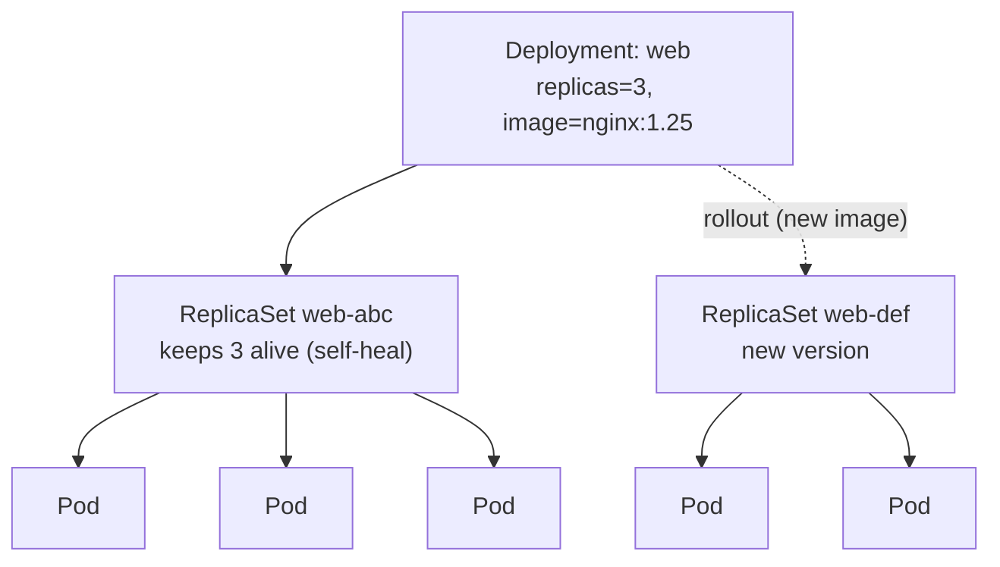

# Module 3 — Deployments

## 🎯 What you'll learn

- The chain **Deployment → ReplicaSet → Pods** and what each layer owns.
- **Self-healing** in action: delete a Pod and watch the controller recreate it.
- How to **scale** with `kubectl scale` (or by editing `replicas`).
- How to **roll out** a new image and watch `rollout status` / `history`.
- How to **roll back** a bad change instantly with `rollout undo`.

## 🐳 Docker bridge

In Docker Compose you can `docker compose up --scale web=3` to get three
containers. But if one crashes or the host reboots, Compose doesn't *keep* it at
three — there's no ongoing controller. A **Deployment** declares "there should
always be 3" and a controller enforces that **forever** (Module 1's reconcile
loop). It also gives you versioned **rollouts** and one-command **rollbacks** —
things Compose has no concept of.

| | Docker Compose | Kubernetes Deployment |
|---|---------------|----------------------|
| Scale to N | `--scale web=3` (one-time) | `replicas: 3` (continuously enforced) |
| Pod dies | stays down | recreated automatically |
| New version | rebuild + restart | controlled rollout, watchable |
| Bad version | manual rollback | `kubectl rollout undo` |

## 🧠 Concept

You almost never create Pods directly (Module 2). Instead you create a
**Deployment**, and it manages Pods *through* a **ReplicaSet**:

- **Deployment** — the thing you edit. Owns rollout history and strategy.
  "I want N copies of this Pod template, at this version."
- **ReplicaSet** — the worker the Deployment creates. Its only job: keep exactly
  N Pods matching a label selector alive. **This is the self-healing layer.**
- **Pods** — the actual running containers, stamped from the template.

```
Deployment (web)
  └── ReplicaSet (web-abc123)   ← keeps N pods alive (self-heal)
        ├── Pod web-abc123-aaa
        ├── Pod web-abc123-bbb
        └── Pod web-abc123-ccc
```

**Self-healing.** Delete a Pod and the ReplicaSet notices "I see 2, I want 3"
and creates a replacement — no human involved. That's reconciliation.

**Rollouts.** Change the Pod template (e.g. a new image) and the Deployment
creates a **new ReplicaSet** for the new version and gradually shifts Pods from
old → new (default `RollingUpdate`, the deep dive is Module 4). Each change is a
**revision** you can inspect and undo.

**The selector contract.** `spec.selector.matchLabels` must match
`spec.template.metadata.labels`. The selector is how the controller *finds* the
Pods it owns. Mismatch them and the API rejects the Deployment.

## 📊 Diagram



A rollout = make a new ReplicaSet and shift Pods to it. A rollback = shift back
to the old ReplicaSet.

## 📋 Cheatsheet

```bash
# --- create / inspect ---
kubectl apply -f deployment.yaml
kubectl get deploy,rs,pods -l app=web    # see all three layers at once
kubectl describe deploy web

# --- scale ---
kubectl scale deploy/web --replicas=5
# (or edit replicas in the YAML and re-apply)

# --- roll out a new version ---
kubectl set image deploy/web nginx=nginx:1.26
kubectl rollout status deploy/web        # blocks until done (or fails)
kubectl rollout history deploy/web       # list revisions
kubectl rollout history deploy/web --revision=2

# --- roll back ---
kubectl rollout undo deploy/web                 # to previous revision
kubectl rollout undo deploy/web --to-revision=1 # to a specific one

# --- restart all pods (re-pull config/image:tag) ---
kubectl rollout restart deploy/web

# --- cleanup ---
kubectl delete -f deployment.yaml
```

## 🧪 Practice

> Run on `kind-k8s-course`; paste output as you go.

**Step 1 — Create the Deployment and see all three layers.**
```bash
kubectl apply -f manifests/03-deployments/deployment.yaml
kubectl get deploy,rs,pods -l app=web
```
Expected: 1 deployment (`READY 3/3`), 1 replicaset (`DESIRED 3`), 3 pods
`Running`. Note the pod names: `web-<rs-hash>-<random>`.

**Step 2 — Watch self-healing.** Copy one pod name from Step 1, delete it, and
immediately list again.
```bash
kubectl delete pod <one-web-pod-name>
kubectl get pods -l app=web
```
Expected: you'll briefly see one `Terminating` / a new one `ContainerCreating`,
then back to **3 Running**. The ReplicaSet replaced it. ✨

**Step 3 — Scale up.**
```bash
kubectl scale deploy/web --replicas=5
kubectl get pods -l app=web
```
Expected: 5 Pods. (Scale back with `--replicas=3` when you like.)

**Step 4 — Roll out a new image.**
```bash
kubectl set image deploy/web nginx=nginx:1.26
kubectl rollout status deploy/web
```
Expected: progress messages ending in `deployment "web" successfully rolled out`.

**Step 5 — Inspect revisions.**
```bash
kubectl rollout history deploy/web
kubectl get rs -l app=web
```
Expected: at least 2 revisions, and **two** ReplicaSets (old one scaled to 0,
new one at the current replica count).

**Step 6 — Roll back.**
```bash
kubectl rollout undo deploy/web
kubectl rollout status deploy/web
kubectl get deploy web -o jsonpath='{.spec.template.spec.containers[0].image}{"\n"}'
```
Expected: rollout completes and the image is back to `nginx:1.25`.

**Step 7 — Clean up.**
```bash
kubectl delete -f manifests/03-deployments/deployment.yaml
kubectl get pods
```

## ✅ Check yourself

You should now be able to:

- [ ] Explain Deployment → ReplicaSet → Pods and which layer self-heals.
- [ ] Demonstrate self-healing by deleting a Pod and seeing it return.
- [ ] Scale a Deployment up and down.
- [ ] Roll out a new image, read `rollout status`, and roll it back.

**Challenge:** Roll the image forward to a **bad** tag (`kubectl set image
deploy/web nginx=nginx:doesnotexist`). Run `kubectl get pods -l app=web` and
`kubectl rollout status deploy/web` — what state are the new Pods in, and is the
*old* version still serving? Then recover with `kubectl rollout undo deploy/web`.
(This previews why safe rollouts need readiness probes — Module 11.)

## 🐛 Common gotchas

- **`selector` ≠ `template.labels`** → the API rejects the Deployment
  (`selector does not match template labels`). They must agree.
- **Bad image tag** → new Pods stick in `ImagePullBackOff`; with the default
  rolling strategy the **old** Pods keep serving, so the app stays up. Fix the
  tag or `rollout undo`.
- **Editing Pods directly does nothing lasting** → the ReplicaSet reconciles
  them back. Change the Deployment, not the Pods.
- **`scale` vs editing YAML** → `kubectl scale` changes the live object; if your
  YAML still says `replicas: 3`, a later `apply` will scale it back. Keep the
  source of truth in sync.
- **Old ReplicaSets hang around** → that's intentional (rollback history),
  controlled by `revisionHistoryLimit`.
