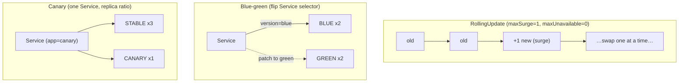

# Module 4 — Deploy strategies

## 🎯 What you'll learn

- The two **built-in** Deployment strategies: **RollingUpdate** (gradual, zero
  downtime) vs **Recreate** (all-down-then-up, with downtime).
- How **`maxSurge`** and **`maxUnavailable`** shape a rolling update.
- **Blue-green** deploys: run two versions, switch instantly by flipping a
  Service selector.
- **Canary** deploys: send a *fraction* of traffic to a new version by replica
  ratio behind a shared Service.

## 🐳 Docker bridge

With Docker you'd stop the old container and start the new one — a hard cutover
with downtime, and no easy way to run old + new side by side. Kubernetes treats
"how do I replace version N with N+1" as a first-class, configurable concern:
roll gradually, swap atomically, or trickle traffic to the new version and watch
before committing. None of this exists in plain Docker.

## 🧠 Concept

### Built-in strategies (set on the Deployment itself)

- **RollingUpdate** (the default): replace Pods a few at a time. Old and new run
  together briefly, so the app stays up. Tuned by:
  - **`maxSurge`** — how many *extra* Pods (above `replicas`) may exist during
    the roll. Higher = faster, more resource use.
  - **`maxUnavailable`** — how many Pods may be *missing* (below `replicas`)
    during the roll. `0` = never drop capacity (needs room to surge).
- **Recreate**: terminate **all** old Pods, then start the new ones. Simple and
  guarantees only one version runs at once — but there's a **downtime gap**. Use
  it when two versions truly can't coexist (e.g. an incompatible schema).

### Patterns you build yourself (with labels + Services)

These aren't a `strategy:` field — you compose them from Deployments + Services
(Module 5 covers Services properly; here we just use one as a traffic switch).

- **Blue-green**: run the old ("blue") and new ("green") versions as **two**
  Deployments. A Service selects one color. To release, **patch the selector**
  to the other color — traffic flips instantly and atomically. Easy rollback:
  flip back.
- **Canary**: run a small new version ("canary") alongside the stable one, both
  matched by **one** Service. Traffic splits by **replica ratio** (3 stable :
  1 canary ≈ 75/25). Watch the canary's errors/metrics, then scale it up (and
  stable down) to promote — or delete it to abort.

> Note: canary-by-replicas is coarse (it's just round-robin over Pods). Weighted
> or header-based routing needs an Ingress controller or service mesh — beyond
> this module, but the label/Service idea is the foundation.

## 📊 Diagram



## 📋 Cheatsheet

```bash
# --- strategy fields (in the Deployment spec) ---
# strategy.type: RollingUpdate | Recreate
# strategy.rollingUpdate.maxSurge / maxUnavailable

# --- trigger & watch a roll ---
kubectl set image deploy/rolling nginx=nginx:1.26
kubectl rollout status deploy/rolling
kubectl get pods -l app=rolling -w        # watch pods cycle live (Ctrl+C to stop)

# --- blue-green: flip the Service selector ---
kubectl patch svc bluegreen -p '{"spec":{"selector":{"app":"bluegreen","version":"green"}}}'

# --- canary: shift traffic by changing replica counts ---
kubectl scale deploy/canary-canary --replicas=3   # more traffic to new
kubectl scale deploy/canary-stable --replicas=1   # less to old

# --- send test traffic from inside the cluster ---
kubectl run tmp --image=curlimages/curl --restart=Never -i --rm -- -s http://SVCNAME
```

## 🧪 Practice

> Run on `kind-k8s-course`; paste output as you go.

### Part A — RollingUpdate vs Recreate

**Step 1 — Rolling update, watched live.**
```bash
kubectl apply -f manifests/04-deploy-strategies/rolling.yaml
kubectl rollout status deploy/rolling
# in one window start a watch, then trigger the roll:
kubectl get pods -l app=rolling -w
```
In a second terminal:
```bash
kubectl set image deploy/rolling nginx=nginx:1.26
```
Watch the first window: a **new** Pod appears (surge +1) and goes Ready *before*
an old one is removed (`maxUnavailable=0`). Count never drops below 4. Ctrl+C
the watch when done.

**Step 2 — Recreate, watched live.**
```bash
kubectl apply -f manifests/04-deploy-strategies/recreate.yaml
kubectl rollout status deploy/recreate
kubectl get pods -l app=recreate -w
```
Second terminal:
```bash
kubectl set image deploy/recreate nginx=nginx:1.26
```
Now **all 4 old Pods terminate first**, you briefly have **0 running**
(downtime!), then 4 new ones start. That's the trade-off.

### Part B — Blue-green

**Step 3 — Run both colors behind one Service.**
```bash
kubectl apply -f manifests/04-deploy-strategies/blue.yaml -f manifests/04-deploy-strategies/green.yaml -f manifests/04-deploy-strategies/bluegreen-svc.yaml
kubectl rollout status deploy/blue
kubectl rollout status deploy/green
```

**Step 4 — Hit the Service (it's serving blue).**
```bash
kubectl run tmp --image=curlimages/curl --restart=Never -i --rm -- -s http://bluegreen
```
Expected: `I am BLUE`.

**Step 5 — Flip to green and hit it again.**
```bash
kubectl patch svc bluegreen -p '{"spec":{"selector":{"app":"bluegreen","version":"green"}}}'
kubectl run tmp --image=curlimages/curl --restart=Never -i --rm -- -s http://bluegreen
```
Expected: `I am GREEN`. The switch was instant — no pod restarts, just a
selector change. (Flip back by patching `version` to `blue`.)

### Part C — Canary

**Step 6 — Stable (3) + canary (1) behind one Service.**
```bash
kubectl apply -f manifests/04-deploy-strategies/canary-stable.yaml -f manifests/04-deploy-strategies/canary-canary.yaml
kubectl rollout status deploy/canary-stable
kubectl rollout status deploy/canary-canary
```

**Step 7 — Send a burst of requests and see the split.**
```bash
kubectl run hammer --image=curlimages/curl --restart=Never -i --rm --command -- sh -c 'for i in $(seq 1 12); do curl -s http://canary; done'
```
Expected: ~9 `STABLE v1` and ~3 `CANARY v2` (≈ the 3:1 replica ratio).

**Step 8 — Promote the canary (shift all traffic to v2).**
```bash
kubectl scale deploy/canary-canary --replicas=3
kubectl scale deploy/canary-stable --replicas=0
kubectl run hammer --image=curlimages/curl --restart=Never -i --rm --command -- sh -c 'for i in $(seq 1 8); do curl -s http://canary; done'
```
Expected: all `CANARY v2`. You just promoted by changing replica counts.

**Step 9 — Clean up everything.**
```bash
kubectl delete -f manifests/04-deploy-strategies/
kubectl get pods
```

## ✅ Check yourself

You should now be able to:

- [ ] Explain RollingUpdate vs Recreate and the downtime trade-off.
- [ ] Say what `maxSurge` and `maxUnavailable` each control.
- [ ] Perform a blue-green switch by patching a Service selector.
- [ ] Perform (and promote) a canary by adjusting replica counts.

**Challenge:** On the `rolling` Deployment, set `maxSurge: 0` and
`maxUnavailable: 1` (edit the YAML, re-apply), trigger a roll, and watch. How is
the pod behavior different from `maxSurge=1, maxUnavailable=0`? Which one keeps
full capacity throughout, and which one is gentler on resources?

## 🐛 Common gotchas

- **`Recreate` = real downtime** — fine for dev or schema-incompatible changes,
  not for always-on services.
- **`maxUnavailable: 0` needs surge room** — the cluster must have capacity for
  the extra Pod, or the roll stalls.
- **No readiness probe = unsafe rolls** — without one (Module 11), a Pod counts
  as "available" the instant it starts, so a rolling update can route traffic to
  a not-yet-ready Pod. Probes make rollouts actually safe.
- **Blue-green doubles resources** — both colors run at full size during the
  overlap. Plan capacity.
- **Canary split is coarse** — it's replica-ratio round-robin, not weighted
  routing. For precise percentages you need an Ingress/mesh.
- **Forgot a label** — if a Deployment's Pod labels don't match the Service
  selector, the Service silently has no endpoints for it (more in Module 5).
