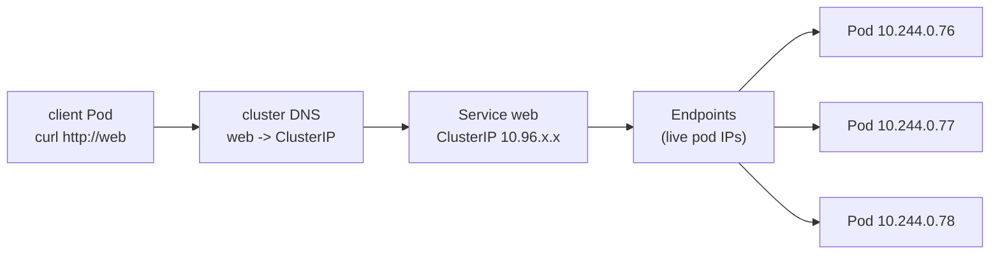

# Module 5 — Services

## 🎯 What you'll learn

- Why Pods need a **Service** in front of them: Pod IPs are ephemeral; a Service
  is a **stable address** that survives pod churn.
- The three main types: **ClusterIP** (in-cluster), **NodePort** (external via a
  node port), **LoadBalancer** (cloud external).
- How a Service's **`selector`** produces its **Endpoints** (the live set of Pod
  IPs) — and how that set auto-updates.
- Cluster **DNS**: reach a Service by name (`web`) or FQDN
  (`web.<namespace>.svc.cluster.local`).

## 🐳 Docker bridge

In Docker Compose, services on the same network can reach each other by name
(`http://api:3000`) — Compose runs a little DNS for you. Kubernetes does the same
but for an *elastic, self-healing* set of Pods: the Service name stays put while
the Pods behind it are created, killed, and rescheduled with **new IPs** every
time. You never chase a Pod IP; you talk to the Service.

| | Docker Compose | Kubernetes Service |
|---|---------------|--------------------|
| Stable name | service name on the network | Service DNS name |
| Backends | the container(s) for that service | all Pods matching the selector |
| When a backend restarts | new container, same name | new Pod IP, Service updates automatically |
| External access | `ports:` mapping | NodePort / LoadBalancer |

## 🧠 Concept

Pods are cattle, not pets: they die and get replaced with **brand-new IPs**. So
you never connect to a Pod IP directly. A **Service** gives you:

- A **stable virtual IP** (`ClusterIP`) that never changes for the life of the
  Service, and
- A **DNS name** so you don't even need the IP.

**How it finds backends — selector → Endpoints.** A Service has a `selector`
(e.g. `app: web`). Kubernetes continuously watches for Pods matching it and keeps
an **Endpoints** object listing their IP:port. Pod appears → added; Pod dies →
removed. Traffic to the Service is load-balanced across the current Endpoints.

> 🔑 **The #1 Service bug:** selector doesn't match any Pod labels → **empty
> Endpoints** → connections hang or refuse. Always check `kubectl get endpoints`.

**The three types:**

| Type | Reachable from | Use |
|------|----------------|-----|
| **ClusterIP** (default) | inside the cluster only | service-to-service comms |
| **NodePort** | outside, via `<nodeIP>:<30000-32767>` | quick external access, dev |
| **LoadBalancer** | outside, via a cloud LB IP | production external (needs cloud) |

NodePort and LoadBalancer are supersets — they *also* get a ClusterIP.

**`port` vs `targetPort`.** `port` is the Service's port (what clients call);
`targetPort` is the container's port (where traffic lands). They're often the
same but don't have to be.

**Cluster DNS.** Every Service gets a DNS record. From any Pod:
- same namespace: `http://web`
- other namespace: `http://web.<namespace>`
- fully qualified: `http://web.<namespace>.svc.cluster.local`

## 📊 Diagram



Pods churn → Endpoints update → the Service IP/name stay constant.

## 📋 Cheatsheet

```bash
# --- create & inspect ---
kubectl apply -f svc.yaml
kubectl get svc                       # types, cluster IPs, ports
kubectl get endpoints web             # the live pod IPs behind a Service
kubectl describe svc web

# --- quick imperative Service from a Deployment ---
kubectl expose deploy/web --port=80 --target-port=80            # ClusterIP
kubectl expose deploy/web --port=80 --type=NodePort --name=web-np

# --- reach a Service ---
# from inside the cluster (DNS):
kubectl run tmp --image=curlimages/curl --restart=Never -i --rm -- -s http://web
# from your laptop (works for any type):
kubectl port-forward svc/web 8080:80      # then open http://localhost:8080

# --- DNS names ---
# web                         (same namespace)
# web.<ns>                    (other namespace)
# web.<ns>.svc.cluster.local  (fully qualified)
```

## 🧪 Practice

> Run on `kind-k8s-course`; paste output as you go.

**Step 1 — Backends + a ClusterIP Service.**
```bash
kubectl apply -f manifests/05-services/deployment.yaml -f manifests/05-services/clusterip.yaml
kubectl rollout status deploy/web
kubectl get svc web
```
Expected: a `ClusterIP` Service `web` with a `CLUSTER-IP` and port 80.

**Step 2 — See the Endpoints track the Pods.**
```bash
kubectl get endpoints web
```
Expected: **3** IP:port entries (one per Pod). Delete a pod
(`kubectl delete pod <name>`) and re-run — a new IP appears as the replacement
Pod joins. The Service membership is live.

**Step 3 — Reach it by DNS from inside the cluster.**
```bash
kubectl run tmp --image=curlimages/curl --restart=Never -i --rm -- -s http://web
```
Expected: nginx's HTML. You used the name `web` — no IP needed.

**Step 4 — Try the fully-qualified name.**
```bash
kubectl run tmp --image=curlimages/curl --restart=Never -i --rm -- -s -o /dev/null -w "HTTP %{http_code}\n" http://web.default.svc.cluster.local
```
Expected: `HTTP 200`.

**Step 5 — Add a NodePort and reach it from your laptop.**
```bash
kubectl apply -f manifests/05-services/nodeport.yaml
kubectl get svc web-nodeport
```
Expected: `PORT(S)` shows `80:30080/TCP`. On **kind**, that node port isn't
auto-published to Windows, so use port-forward to reach it from your laptop:
```bash
kubectl port-forward svc/web 8080:80
```
Then in a browser or another terminal: `curl http://localhost:8080` → nginx page.
Ctrl+C to stop the forward.

**Step 6 — Break it on purpose (the classic bug).**
```bash
kubectl patch svc web -p '{"spec":{"selector":{"app":"nope"}}}'
kubectl get endpoints web
```
Expected: Endpoints is now **empty** — the selector matches no Pods. Requests
would hang/refuse. Fix it:
```bash
kubectl patch svc web -p '{"spec":{"selector":{"app":"web"}}}'
kubectl get endpoints web
```

**Step 7 — Clean up.**
```bash
kubectl delete -f manifests/05-services/
```

## ✅ Check yourself

You should now be able to:

- [ ] Explain why you target a Service, not a Pod IP.
- [ ] Read `kubectl get endpoints` and relate it to the selector.
- [ ] Reach a Service by short name and by FQDN from inside the cluster.
- [ ] Compare ClusterIP / NodePort / LoadBalancer.

**Challenge:** Without the cheatsheet, expose the `web` Deployment with a second
Service of type ClusterIP named `web2` using `kubectl expose`, confirm its
Endpoints match `web`'s, then curl `http://web2` from a temp pod.

## 🐛 Common gotchas

- **Empty Endpoints** → selector ↔ Pod label mismatch. The #1 cause of "Service
  won't connect". Check `kubectl get endpoints`.
- **`LoadBalancer` stuck `<pending>`** → no cloud provider on kind/local. Use
  NodePort or `kubectl port-forward` instead.
- **NodePort not reachable on kind** → kind runs the "node" inside a container;
  the node port isn't published to your host unless you configured
  `extraPortMappings` at cluster creation. `port-forward` always works.
- **`port` vs `targetPort`** → `port` is what clients hit on the Service;
  `targetPort` must match the **container** port. Mixing them up = connection
  refused.
- **Wrong namespace** → calling `web` from another namespace fails; use
  `web.<namespace>` or the FQDN.
