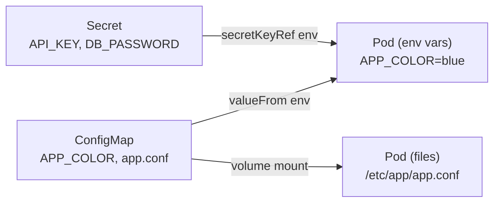

# Module 6 — Config (ConfigMaps & Secrets)

## 🎯 What you'll learn

- Store non-secret config in a **ConfigMap**, sensitive values in a **Secret**.
- Inject config two ways: as **environment variables** and as **mounted files**.
- Why env injected from a CM/Secret needs a **pod restart** to change (and
  mounted files update on their own, eventually).
- Why a Secret is **not** encryption, and why you don't commit real Secrets to git.

## 🐳 Docker bridge

In Docker you pass config with `-e KEY=val` and mount files with
`-v ./conf:/etc/app`. Kubernetes promotes both to **first-class objects** you
create once and reuse across many Pods: a **ConfigMap** (plain config) and a
**Secret** (sensitive config). Pods then reference them — so config lives apart
from images, and you change it without rebuilding.

## 🧠 Concept

**Separate config from code.** The same image should run in dev/staging/prod
with different settings. ConfigMaps and Secrets hold those settings outside the
image.

- **ConfigMap** — non-sensitive key/value data (URLs, flags, whole config files).
- **Secret** — same shape, for sensitive data (passwords, API keys, tokens).
  Stored **base64-encoded** — that's *encoding for transport*, **not encryption**.

**Two ways to consume either one:**

1. **As environment variables** — inject specific keys with `valueFrom`
   (`configMapKeyRef` / `secretKeyRef`), or all keys with `envFrom`.
   ⚠️ Env vars are read **once at container start**. Change the CM/Secret and the
   running Pod keeps the old value until you **`kubectl rollout restart`**.
2. **As mounted files** — mount the CM/Secret as a volume; each key becomes a
   file. Mounted files **do** update after a change (kubelet sync, ~1 min), but
   your app must re-read the file to notice.

| | Env var injection | Volume (file) injection |
|---|------------------|------------------------|
| Good for | a handful of settings | config files, certs, many keys |
| Updates live? | **No** — needs `rollout restart` | Yes (eventually), if app re-reads |
| How | `valueFrom` / `envFrom` | `volumes` + `volumeMounts` |

## 📊 Diagram



## 📋 Cheatsheet

```bash
# --- create imperatively (handy, prints YAML with --dry-run) ---
kubectl create configmap app-config --from-literal=APP_COLOR=blue --dry-run=client -o yaml
kubectl create configmap app-config --from-file=app.conf
kubectl create secret generic app-secret --from-literal=API_KEY=s3cr3t

# --- inspect ---
kubectl get configmap,secret
kubectl describe configmap app-config
kubectl get secret app-secret -o jsonpath='{.data.API_KEY}' | base64 -d   # decode (Linux/Git Bash)

# --- consume in a pod ---
# env:   valueFrom.configMapKeyRef / secretKeyRef   (one key)
# env:   envFrom.configMapRef / secretRef           (all keys)
# files: spec.volumes[].configMap + volumeMounts[]

# --- apply a config change to a RUNNING deployment (env needs this!) ---
kubectl rollout restart deploy/app-env
```

## 🧪 Practice

> Run on `kind-k8s-course`; paste output as you go. The `cat` step targets a
> container path — use **PowerShell**, not Git Bash.

**Step 1 — Create the ConfigMap, Secret, and both consumer Deployments.**
```bash
kubectl apply -f manifests/06-config/
kubectl rollout status deploy/app-env
kubectl rollout status deploy/app-vol
```

**Step 2 — See config injected as env vars.**
```bash
kubectl exec deploy/app-env -- env | findstr /R "APP_COLOR API_KEY"
```
Expected: `APP_COLOR=blue` (from the ConfigMap) and `API_KEY=s3cr3t-key-123`
(from the Secret).

**Step 3 — See config injected as a file.**
```bash
kubectl exec deploy/app-vol -- cat /etc/app/app.conf
```
Expected: the contents of the `app.conf` key — now a real file in the container.

**Step 4 — Prove env does NOT update live.**
```bash
kubectl patch configmap app-config -p '{\"data\":{\"APP_COLOR\":\"green\"}}'
kubectl exec deploy/app-env -- env | findstr APP_COLOR
```
Expected: still `APP_COLOR=blue` — the running Pod cached it at startup.

**Step 5 — Apply the change with a restart.**
```bash
kubectl rollout restart deploy/app-env
kubectl rollout status deploy/app-env
kubectl exec deploy/app-env -- env | findstr APP_COLOR
```
Expected: now `APP_COLOR=green`. That's the key operational habit: **CM/Secret
env changes need a `rollout restart`.**

**Step 6 — Clean up.**
```bash
kubectl delete -f manifests/06-config/
```

## ✅ Check yourself

You should now be able to:

- [ ] Create a ConfigMap and a Secret and explain when to use each.
- [ ] Inject a value as an env var and as a mounted file.
- [ ] Explain why an env change needs a `rollout restart`.
- [ ] State why a Secret is not "secure" by itself.

**Challenge:** Decode the `DB_PASSWORD` from the Secret without applying it to a
pod: `kubectl get secret app-secret -o jsonpath='{.data.DB_PASSWORD}'` then
base64-decode it. What does that tell you about who can read Secrets if they have
`get secret` permission? (Foreshadows RBAC, Module 12.)

## 🐛 Common gotchas

- **Secrets are base64, not encrypted** — anyone who can `get` the Secret can
  decode it. Control access with RBAC (Module 12); enable encryption-at-rest in
  real clusters.
- **Env changes don't apply live** — you must `kubectl rollout restart`. This
  surprises everyone once.
- **`envFrom` skips invalid keys** — keys that aren't valid env var names (e.g.
  `app.conf` with a dot) are silently skipped for env injection; use them as
  files instead.
- **Never `git add` real Secrets** — use sealed-secrets / external secret stores
  for real projects; keep example values only in the repo.
- **Mounted CM is read-only** — the container can't write back to it.
