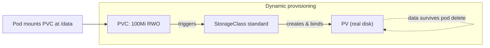

# Module 7 — Storage

## 🎯 What you'll learn

- The difference between **ephemeral** storage (dies with the Pod) and
  **persistent** storage (survives).
- How a **PVC** (request) binds to a **PV** (resource), and how a
  **StorageClass** provisions PVs **dynamically**.
- Prove data survives Pod deletion when it lives on a PVC.
- Intro to **StatefulSets**: stable pod identity + a **PVC per pod**.

## 🐳 Docker bridge

In Docker you keep data with **named volumes** (`docker volume create`,
`-v data:/var/lib/...`). Kubernetes splits that into two objects: a
**PersistentVolumeClaim (PVC)** — "I need 100Mi of read-write storage" — and a
**PersistentVolume (PV)** — the actual provisioned disk. A **StorageClass**
auto-creates the PV to satisfy the claim, so you usually just write a PVC and let
the cluster do the rest.

## 🧠 Concept

**Ephemeral vs persistent.**
- A container's filesystem and `emptyDir` volumes **die when the Pod dies**.
  Fine for caches/scratch, fatal for databases.
- A **PersistentVolume** is storage with a lifecycle **independent** of any Pod.

**The PVC ↔ PV ↔ StorageClass dance:**

1. You create a **PVC**: "I want 100Mi, ReadWriteOnce."
2. A **StorageClass** (kind ships a default `standard`) **dynamically
   provisions** a matching **PV** and **binds** it to your PVC.
3. A Pod mounts the **PVC**; the data lands on the PV and outlives the Pod.

```
PVC (request)  --bound to-->  PV (real disk)
   ^                              ^
   | mounts                       | provisioned by
 Pod                          StorageClass
```

**Access modes:** `ReadWriteOnce` (one node r/w — the common default),
`ReadOnlyMany`, `ReadWriteMany` (needs networked storage like NFS).

**StatefulSets** — for apps that need **identity** (databases, queues):
- Pods get **stable, ordered names**: `web-0`, `web-1` (not random hashes).
- Each pod gets its **own PVC** from a `volumeClaimTemplate` (`www-web-0`,
  `www-web-1`) — so each replica keeps its own data.
- They need a **headless Service** (`clusterIP: None`) for per-pod DNS.
- Deleting the StatefulSet **does not delete the PVCs** (your data is safe — and
  also lingers until you remove it).

| | Deployment | StatefulSet |
|---|-----------|-------------|
| Pod names | random (`web-7d5...-x`) | stable (`web-0`, `web-1`) |
| Storage | usually shared/none | one PVC per pod |
| Use | stateless apps | databases, stateful apps |

## 📊 Diagram



## 📋 Cheatsheet

```bash
# --- storage objects ---
kubectl get storageclass            # provisioners available (kind: 'standard')
kubectl get pvc                     # claims (want STATUS=Bound)
kubectl get pv                      # the actual volumes
kubectl describe pvc data-pvc       # why a PVC is Pending, events

# --- statefulset ---
kubectl get statefulset
kubectl get pods -l app=web-sts     # web-0, web-1 (stable names)

# --- cleanup note: STS leaves PVCs behind on purpose ---
kubectl delete statefulset web
kubectl delete pvc www-web-0 www-web-1   # remove data explicitly
```

## 🧪 Practice

> Run on `kind-k8s-course`; paste output as you go. The `cat` steps target
> container paths — use **PowerShell**.

**Step 1 — Create a PVC and confirm it Binds.**
```bash
kubectl get storageclass
kubectl apply -f manifests/07-storage/pvc.yaml
kubectl get pvc data-pvc
```
Expected: `STATUS = Bound` (kind's `standard` class provisioned a PV for it).

**Step 2 — Mount it and write data.**
```bash
kubectl apply -f manifests/07-storage/pod-pvc.yaml
kubectl wait --for=condition=Ready pod/writer --timeout=90s
kubectl exec writer -- sh -c 'echo persisted-data > /data/file.txt; cat /data/file.txt'
```
Expected: `persisted-data`.

**Step 3 — Prove persistence: delete the pod, recreate, read back.**
```bash
kubectl delete pod writer
kubectl apply -f manifests/07-storage/pod-pvc.yaml
kubectl wait --for=condition=Ready pod/writer --timeout=90s
kubectl exec writer -- cat /data/file.txt
```
Expected: still `persisted-data` — the new Pod re-mounted the **same** PVC. 🎯

**Step 4 — StatefulSet: stable names + per-pod PVCs.**
```bash
kubectl apply -f manifests/07-storage/statefulset.yaml
kubectl rollout status statefulset/web
kubectl get pods -l app=web-sts
kubectl get pvc
```
Expected: pods `web-0` and `web-1` (stable, ordered), plus PVCs `www-web-0` and
`www-web-1` — one per pod.

**Step 5 — Clean up (note: must delete PVCs explicitly).**
```bash
kubectl delete -f manifests/07-storage/
kubectl delete pvc data-pvc www-web-0 www-web-1
kubectl get pvc
```

## ✅ Check yourself

You should now be able to:

- [ ] Explain ephemeral vs persistent storage.
- [ ] Describe how a PVC binds to a PV via a StorageClass.
- [ ] Demonstrate data surviving a Pod deletion.
- [ ] Explain how a StatefulSet differs from a Deployment (identity + per-pod PVC).

**Challenge:** After Step 4, write a unique file into `web-0`
(`kubectl exec web-0 -- sh -c 'echo i-am-zero > /usr/share/nginx/html/id'`),
delete just that pod (`kubectl delete pod web-0`), wait for it to come back, and
read the file. Did `web-0` keep its own data? Why does that matter for a database?

## 🐛 Common gotchas

- **PVC stuck `Pending`** → no StorageClass/provisioner can satisfy it (wrong
  `storageClassName`, or none default). `kubectl describe pvc` shows why.
- **`ReadWriteOnce` ≠ multi-node** → only one node can mount it r/w; a pod on
  another node can't attach it. Need `ReadWriteMany` + networked storage.
- **Deleting a StatefulSet keeps its PVCs** → intentional (data safety), but they
  cost space until you delete them by hand.
- **`emptyDir` is not persistent** → it's wiped when the Pod is removed; only
  PV-backed volumes survive.
- **`WaitForFirstConsumer`** → kind's default class only provisions the PV once a
  Pod actually uses the PVC, so a fresh PVC may sit unbound until a pod mounts it.
