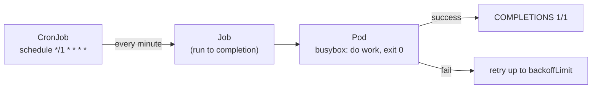

# Module 8 — Jobs & CronJobs

## 🎯 What you'll learn

- Run a one-off task to **completion** with a **Job** (not a never-ending Pod).
- Control retries with **`backoffLimit`** and auto-cleanup with
  **`ttlSecondsAfterFinished`**.
- Schedule recurring work with a **CronJob** (cron syntax).
- Tune CronJob behavior: **`concurrencyPolicy`** and history limits.

## 🐳 Docker bridge

A normal Deployment Pod is meant to run **forever** (a server). But some work is
**finite**: a migration, a nightly report, a backup. In Docker you'd
`docker run` a batch container and watch it exit, or use host `cron`. Kubernetes
gives you **Jobs** (run-to-completion, with retries) and **CronJobs**
(scheduled Jobs) as managed, tracked objects.

## 🧠 Concept

**Job** = "run this Pod until it succeeds, then stop."
- `completions`: how many successful runs you need (default 1).
- `parallelism`: how many Pods run at once.
- `backoffLimit`: how many times to retry on failure before the Job is `Failed`.
- `restartPolicy`: must be `Never` or `OnFailure` (never `Always` — that's for
  servers).
- `ttlSecondsAfterFinished`: auto-delete the Job (and its Pods) this long after
  it finishes, so completed Jobs don't pile up.

**CronJob** = "create a Job on a schedule."
- `schedule`: standard cron, e.g. `*/1 * * * *` (every minute),
  `0 2 * * *` (daily at 02:00).
- `jobTemplate`: the Job to create each time.
- `concurrencyPolicy`: `Allow` (default), `Forbid` (skip if previous still
  running), or `Replace` (kill old, start new).
- `successfulJobsHistoryLimit` / `failedJobsHistoryLimit`: how many finished Jobs
  to keep for inspection.

```
CronJob --(on schedule)--> Job --> Pod(s) --> run to completion
```

## 📊 Diagram



## 📋 Cheatsheet

```bash
# --- jobs ---
kubectl apply -f job.yaml
kubectl get jobs                          # COMPLETIONS column (e.g. 1/1)
kubectl logs job/hello-job                # logs of the job's pod
kubectl describe job hello-job

# --- cronjobs ---
kubectl get cronjobs                      # SCHEDULE, LAST SCHEDULE, ACTIVE
kubectl create job --from=cronjob/hello-cron manual-run   # trigger now (no waiting)
kubectl get jobs --watch                  # watch scheduled jobs appear

# --- control ---
kubectl patch cronjob hello-cron -p '{"spec":{"suspend":true}}'   # pause schedule
kubectl delete job hello-job
```

## 🧪 Practice

> Run on `kind-k8s-course`; paste output as you go.

**Step 1 — Run a Job to completion.**
```bash
kubectl apply -f manifests/08-jobs-cronjobs/job.yaml
kubectl wait --for=condition=complete job/hello-job --timeout=90s
kubectl get job hello-job
```
Expected: `COMPLETIONS 1/1`.

**Step 2 — Read the Job's output.**
```bash
kubectl logs job/hello-job
```
Expected: `processing batch...` then `done`.

**Step 3 — Create a CronJob.**
```bash
kubectl apply -f manifests/08-jobs-cronjobs/cronjob.yaml
kubectl get cronjob hello-cron
```
Expected: a CronJob with `SCHEDULE */1 * * * *`.

**Step 4 — Trigger a run now (don't wait for the clock).**
```bash
kubectl create job --from=cronjob/hello-cron manual-run
kubectl wait --for=condition=complete job/manual-run --timeout=90s
kubectl logs job/manual-run
```
Expected: `tick at <date>`.

**Step 5 — (Optional) Watch it fire on schedule.**
```bash
kubectl get jobs --watch
```
Within a minute you'll see a new `hello-cron-<timestamp>` Job appear, run, and
complete. Ctrl+C to stop watching.

**Step 6 — Clean up.**
```bash
kubectl delete -f manifests/08-jobs-cronjobs/
kubectl delete job hello-job manual-run --ignore-not-found
```

## ✅ Check yourself

You should now be able to:

- [ ] Explain how a Job differs from a Deployment Pod.
- [ ] Read `COMPLETIONS` and get a Job's logs.
- [ ] Create a CronJob and trigger a manual run from it.
- [ ] Say what `backoffLimit`, `concurrencyPolicy`, and history limits do.

**Challenge:** Make a Job that **fails** on purpose (change its command to
`sh -c 'echo nope; exit 1'`, name it `fail-job`, `backoffLimit: 2`). Apply it and
watch `kubectl get pods -l job-name=fail-job` — how many Pods get created, and
what's the final Job status? (Explains what `backoffLimit` actually does.)

## 🐛 Common gotchas

- **`restartPolicy: Always` is invalid for Jobs** — use `Never` or `OnFailure`.
- **Failed Jobs retry then give up** — after `backoffLimit` retries the Job is
  `Failed`; the Pods stick around for debugging.
- **Completed Jobs pile up** — set `ttlSecondsAfterFinished` (or history limits
  on CronJobs) or you'll accumulate finished Jobs/Pods.
- **CronJob timezone** — defaults to the controller's TZ; set `spec.timeZone`
  (e.g. `"Asia/Bangkok"`) on modern clusters if you need a specific zone.
- **Overlapping runs** — if a run can outlast its interval, use
  `concurrencyPolicy: Forbid` or `Replace` to avoid pile-ups.
