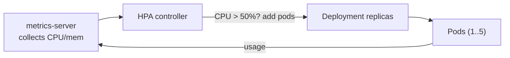

# Module 9 — Scaling

## 🎯 What you'll learn

- Scale **manually** (`replicas`) vs **automatically** (HPA).
- Set resource **`requests`** (what the scheduler reserves) vs **`limits`**
  (the hard cap), and why requests matter for scheduling *and* the HPA.
- Install **metrics-server** (on kind it needs `--kubelet-insecure-tls`) and read
  `kubectl top`.
- Create a **HorizontalPodAutoscaler** on CPU and watch it scale out under load.

## 🐳 Docker bridge

Docker has no autoscaler — you start the containers you want. Kubernetes can
**watch a metric** (CPU, memory, custom) and change the replica count for you.
You declare "keep average CPU near 50%, between 1 and 5 pods" and the HPA
controller does the math continuously (Module 1's reconcile loop, applied to
replica count).

## 🧠 Concept

**Requests vs limits** (per container):
- **`requests`** — the amount the scheduler **reserves** when placing the Pod. A
  node must have this much free or the Pod stays `Pending`. The HPA measures
  usage as a **% of the request**.
- **`limits`** — the hard ceiling. Over the CPU limit → the container is
  **throttled**; over the memory limit → it's **OOMKilled**.

Always set requests; they drive both scheduling and autoscaling.

**Manual scaling:** `kubectl scale deploy/x --replicas=N` (you saw this in
Module 3).

**Horizontal Pod Autoscaler (HPA):** automatically adjusts `replicas` to keep a
metric near a target.
- Needs **metrics-server** running (it supplies CPU/memory usage).
- Needs the target container to have CPU **requests** set (no request → the HPA
  shows `<unknown>` and can't act).
- `minReplicas`/`maxReplicas` bound it; scale-up is quick, scale-down is
  deliberately slow (a stabilization window) to avoid flapping.

> **metrics-server on kind:** kind's kubelet serves metrics over a self-signed
> cert, so metrics-server must be started with `--kubelet-insecure-tls`. The lab
> installs and patches it once; it stays for Module 13 too.

## 📊 Diagram



## 📋 Cheatsheet

```bash
# --- install metrics-server (once) ---
kubectl apply -f https://github.com/kubernetes-sigs/metrics-server/releases/latest/download/components.yaml
# kind only: allow the self-signed kubelet cert
kubectl patch -n kube-system deployment metrics-server --type=json \
  -p '[{"op":"add","path":"/spec/template/spec/containers/0/args/-","value":"--kubelet-insecure-tls"}]'

# --- usage ---
kubectl top nodes
kubectl top pods                      # or: kubectl top pods -l app=php-apache

# --- autoscaling ---
kubectl autoscale deploy/php-apache --cpu-percent=50 --min=1 --max=5   # imperative HPA
kubectl get hpa                       # TARGETS shows current%/target%
kubectl describe hpa php-apache       # scaling events

# requests/limits live in the container spec:
#   resources: { requests: {cpu: 100m, memory: 64Mi}, limits: {cpu: 200m, memory: 128Mi} }
```

## 🧪 Practice

> Run on `kind-k8s-course`; paste output as you go.

**Step 1 — Install metrics-server (once) and patch it for kind.**
```bash
kubectl apply -f https://github.com/kubernetes-sigs/metrics-server/releases/latest/download/components.yaml
kubectl patch -n kube-system deployment metrics-server --type=json -p '[{\"op\":\"add\",\"path\":\"/spec/template/spec/containers/0/args/-\",\"value\":\"--kubelet-insecure-tls\"}]'
kubectl rollout status -n kube-system deployment/metrics-server
```

**Step 2 — Confirm metrics work (wait ~30–40s after install).**
```bash
kubectl top nodes
```
Expected: a row with CPU/MEM numbers (not an error). If you get
"metrics not available yet", wait a bit and retry.

**Step 3 — Deploy the burnable app + HPA.**
```bash
kubectl apply -f manifests/09-scaling/deployment-resources.yaml -f manifests/09-scaling/hpa.yaml
kubectl rollout status deploy/php-apache
kubectl get hpa php-apache
```
Expected: HPA shows `TARGETS 1%/50%` (a real number, **not** `<unknown>`),
`REPLICAS 1`.

**Step 4 — Generate load and watch it scale out.**
```bash
kubectl apply -f manifests/09-scaling/load.yaml
kubectl get hpa php-apache --watch
```
Within ~1–2 min, `TARGETS` shoots past 50% (you'll see e.g. `201%/50%`) and
`REPLICAS` climbs toward 5. Ctrl+C when you've seen it grow.

**Step 5 — Remove load and watch it scale back down.**
```bash
kubectl delete pod load-generator
kubectl get hpa php-apache --watch
```
After a few minutes (the stabilization window) replicas return to 1. Ctrl+C.

**Step 6 — Clean up the lab (keep metrics-server for Module 13).**
```bash
kubectl delete -f manifests/09-scaling/deployment-resources.yaml -f manifests/09-scaling/hpa.yaml
kubectl delete pod load-generator --ignore-not-found
```

## ✅ Check yourself

You should now be able to:

- [ ] Explain requests vs limits and what each affects.
- [ ] Install + verify metrics-server and read `kubectl top`.
- [ ] Create an HPA and explain why it needs requests + metrics-server.
- [ ] Demonstrate scale-out under load and scale-in after.

**Challenge:** Lower the HPA target to `averageUtilization: 20` (edit
`hpa.yaml`, re-apply), generate load again, and compare how aggressively it
scales versus the 50% target. Why does a lower target mean more replicas?

## 🐛 Common gotchas

- **HPA `TARGETS <unknown>`** → either metrics-server isn't running, or the
  target container has **no CPU request**. Both are required.
- **`kubectl top` errors** → metrics-server missing/not ready, or (on kind) the
  `--kubelet-insecure-tls` patch wasn't applied.
- **`OOMKilled`** → the container exceeded its **memory limit**. Raise the limit
  or fix the leak.
- **CPU throttling** → over the CPU **limit** the app is throttled (slower), not
  killed. Watch for it under load.
- **Scale-down feels slow** → that's intentional (stabilization window) to
  prevent flapping.
