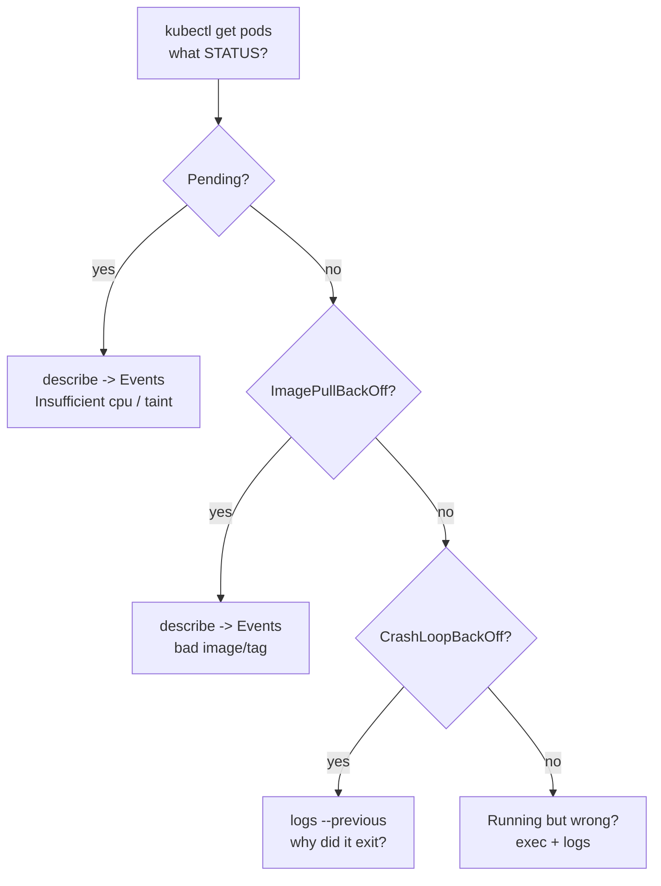

# Module 10 — Debugging (work-readiness core)

## 🎯 What you'll learn

- The **debugging loop** every k8s operator runs: `get` → `describe` → `logs`
  → events → `exec`.
- Map the three failure states you'll see daily to their causes:
  **ImagePullBackOff**, **CrashLoopBackOff**, **Pending** (unschedulable).
- Read a **crashed** container's logs with `--previous`.
- Use `kubectl describe` events to find the *why*, not just the *what*.

## 🐳 Docker bridge

With Docker you'd `docker logs` and `docker inspect` one container. Kubernetes
adds a whole layer of **cluster decisions** — scheduling, image pulls, restarts,
probes — and surfaces them as **events** on the object. So debugging k8s is less
"read the app log" and more "ask the cluster *why* it did what it did", then read
the log. This module is the single most important one for day-to-day work.

## 🧠 Concept

**The loop — run it in order, every time:**

1. **`kubectl get pods`** — what state is it in? (`Running`, `Pending`,
   `ImagePullBackOff`, `CrashLoopBackOff`, `Error`…)
2. **`kubectl describe pod <name>`** — scroll to **Events** at the bottom. This
   explains scheduling, image pulls, probe failures, restarts.
3. **`kubectl logs <name>`** — the app's own output. Add **`--previous`** to see
   the log of a container that already crashed and restarted.
4. **`kubectl get events`** — cluster-wide recent activity (sort by time).
5. **`kubectl exec -it <name> -- sh`** — get inside a *running* container to poke
   around (env, files, connectivity).

**The three states you must recognize instantly:**

| State | Meaning | First move |
|-------|---------|-----------|
| **ImagePullBackOff** / `ErrImagePull` | can't pull the image (bad name/tag, no access) | `describe` → read the pull error; fix the image |
| **CrashLoopBackOff** | container starts then exits repeatedly | `logs --previous` → read why it died |
| **Pending** | not scheduled onto any node | `describe` → Events show *Insufficient cpu/memory* or taints |

> **Rule of thumb:** `Pending` = a **scheduling** problem (look at `describe`
> Events). `CrashLoopBackOff` = an **app** problem (look at `logs`).
> `ImagePullBackOff` = a **registry/image** problem (look at `describe` Events).

## 📊 Diagram



## 📋 Cheatsheet

```bash
kubectl get pods                       # 1. state
kubectl get pods -o wide               #    + node & IP
kubectl describe pod NAME              # 2. EVENTS at the bottom = the 'why'
kubectl logs NAME                      # 3. app output
kubectl logs NAME --previous           #    crashed container's last logs
kubectl logs NAME -c CONTAINER         #    specific container
kubectl get events --sort-by=.lastTimestamp   # 4. recent cluster activity
kubectl exec -it NAME -- sh            # 5. shell inside a running container

# ephemeral debug container (no shell in the image? attach one):
kubectl debug -it NAME --image=busybox --target=CONTAINER
```

## 🧪 Practice

> Run on `kind-k8s-course`. You'll deploy three deliberately broken pods and
> diagnose each. Paste output as you go.

**Step 1 — Deploy the broken trio.**
```bash
kubectl apply -f manifests/10-debugging/
kubectl get pods -l lab=debugging
```
Give it ~20s, then re-run the `get`. Expected states: `broken-image` →
`ImagePullBackOff`, `broken-crashloop` → `CrashLoopBackOff` (or `Error` between
restarts), `broken-pending` → `Pending`.

**Step 2 — Diagnose the image pull failure.**
```bash
kubectl describe pod broken-image
```
Scroll to **Events**. Expected: `Failed to pull image ... not found` /
`ErrImagePull`. The fix would be a real tag (e.g. `nginx:1.25`).

**Step 3 — Diagnose the crash loop (read the app log).**
```bash
kubectl get pod broken-crashloop          # see RESTARTS climbing
kubectl logs broken-crashloop --previous
```
Expected: `FATAL: cannot connect to db` — the reason it keeps exiting. `describe`
would show the `Back-off restarting failed container` event.

**Step 4 — Diagnose the unschedulable pod.**
```bash
kubectl describe pod broken-pending
```
Scroll to **Events**. Expected: `FailedScheduling ... Insufficient cpu` — it
requested more CPU than any node has. The fix: lower the request.

**Step 5 — Cluster-wide events view.**
```bash
kubectl get events --sort-by=.lastTimestamp
```
Expected: a timeline including the pull failure, the back-offs, and the failed
scheduling — one place to see everything that just happened.

**Step 6 — Clean up.**
```bash
kubectl delete -f manifests/10-debugging/
```

## ✅ Check yourself

You should now be able to:

- [ ] Run the get → describe → logs → events → exec loop from memory.
- [ ] Instantly map ImagePullBackOff / CrashLoopBackOff / Pending to a cause.
- [ ] Use `kubectl logs --previous` on a crashed container.
- [ ] Find the "why" in `kubectl describe` Events.

**Challenge:** Without re-reading above, fix `broken-pending` **in place**:
`kubectl edit pod broken-pending` won't allow changing resources on a running
pod — so instead copy the manifest, set `cpu` to `100m`, delete the old pod, and
apply the fix. Confirm it reaches `Running`. Which command told you the original
problem?

## 🐛 Common gotchas

- **`logs` shows nothing for a crashed pod** → use `--previous` (the current
  container may not exist between restarts).
- **Events expire** (~1h) → diagnose promptly; `describe` only shows recent ones.
- **`Pending` is almost always scheduling** → resources, taints/tolerations, or
  node selectors. `describe` Events tell you which.
- **ImagePullBackOff ≠ CrashLoopBackOff** → pull failure (never started) vs run
  failure (started, then exited). Different fixes.
- **No shell in the image** → distroless/scratch images have no `sh`; use
  `kubectl debug` to attach an ephemeral busybox.
