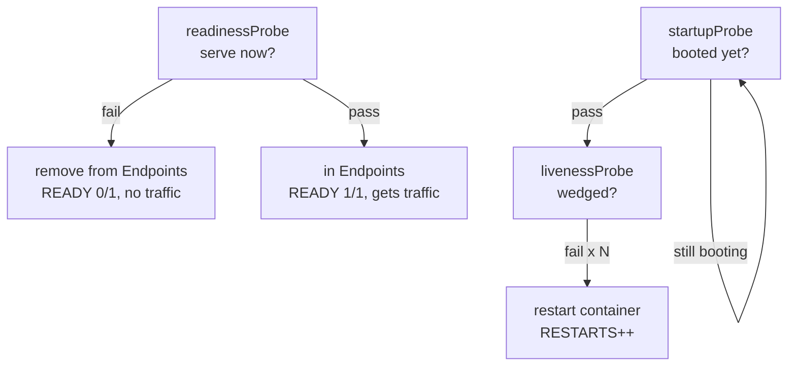

# Module 11 — Health probes

## 🎯 What you'll learn

- The three probe types and what each one *does*:
  **liveness** (restart), **readiness** (gate traffic), **startup** (protect slow boot).
- Configure `httpGet` / `tcpSocket` / `exec` probes and tune their thresholds.
- See readiness control a Service's **Endpoints**, and liveness drive
  **restarts**.
- Avoid the classic foot-guns (aggressive liveness → restart loops).

## 🐳 Docker bridge

Docker has a single `HEALTHCHECK` that just marks a container healthy/unhealthy.
Kubernetes splits "healthy" into **two different questions** with two different
actions:

- *"Is it alive, or wedged?"* → **liveness** → if failing, **restart** it.
- *"Is it ready for traffic right now?"* → **readiness** → if failing, **stop
  sending requests** (remove from the Service) but **don't** restart.

That separation is the whole point of this module.

## 🧠 Concept

A probe periodically checks a container. Three kinds, three behaviors:

| Probe | Question | On failure | Use it for |
|-------|----------|-----------|-----------|
| **livenessProbe** | is the process wedged? | **restart** the container | deadlock/hang recovery |
| **readinessProbe** | can it serve now? | **remove from Service Endpoints** (no traffic) | warmup, dependencies down, overload |
| **startupProbe** | has it finished booting? | hold off liveness/readiness until it passes | slow-starting apps |

**Probe mechanisms:** `httpGet` (2xx/3xx = pass), `tcpSocket` (port open = pass),
`exec` (command exit 0 = pass).

**Key tuning fields:** `initialDelaySeconds`, `periodSeconds`,
`failureThreshold`, `successThreshold`, `timeoutSeconds`.

**Why readiness matters for rollouts (Module 4 callback):** during a
RollingUpdate, a new Pod is only counted "available" once its **readiness** probe
passes — so traffic isn't shifted to a Pod that isn't ready. Without a readiness
probe, k8s assumes "started = ready" and can route to a cold Pod.

**Why startup protects slow apps:** if an app takes 40s to boot, a tight
liveness probe would kill it mid-boot forever. A `startupProbe` says "don't run
liveness/readiness until I've started," then hands over.

## 📊 Diagram



## 📋 Cheatsheet

```yaml
# in a container spec:
startupProbe:
  httpGet: { path: /, port: 80 }
  failureThreshold: 30        # 30 * periodSeconds to finish starting
  periodSeconds: 2
readinessProbe:
  httpGet: { path: /, port: 80 }
  periodSeconds: 5
  failureThreshold: 2
livenessProbe:
  httpGet: { path: /, port: 80 }
  periodSeconds: 5
  failureThreshold: 3
# other mechanisms:
#   tcpSocket: { port: 5432 }
#   exec: { command: ["cat", "/tmp/ready"] }
```

```bash
kubectl get pods                 # READY column reflects readiness
kubectl get endpoints web        # ready pods only
kubectl describe pod NAME        # Events show probe failures + restarts
```

## 🧪 Practice

> Run on `kind-k8s-course`. The `rm` step targets a container path — use
> **PowerShell**. Paste output as you go.

**Step 1 — Deploy probed pods + a Service.**
```bash
kubectl apply -f manifests/11-health-probes/
kubectl rollout status deploy/web
kubectl get pods -l app=web
```
Expected: 2 pods, `READY 1/1` (they only flip to Ready once readiness passes).

**Step 2 — Readiness gates Endpoints.**
```bash
kubectl get endpoints web
```
Expected: 2 IPs — only *ready* pods are listed. (If you caught them mid-startup,
the list would be shorter until they pass readiness.)

**Step 3 — Break liveness on one pod and watch it restart.**
Make nginx return 403 by deleting the file it serves, so the `httpGet /` probe
fails:
```bash
$pod = kubectl get pods -l app=web -o jsonpath='{.items[0].metadata.name}'
kubectl exec $pod -- rm /usr/share/nginx/html/index.html
kubectl get pod $pod --watch
```
Expected sequence: `READY 1/1` → `READY 0/1` (readiness failed → removed from
Endpoints, no traffic) → after the liveness threshold, **`RESTARTS` becomes 1**
and it returns to `READY 1/1` (the restart gives it a fresh filesystem). Ctrl+C
when you've seen the restart. 🎯

**Step 4 — Confirm it left and rejoined the Service.**
While it was `0/1`, run `kubectl get endpoints web` in another terminal — that
pod's IP disappears, then reappears after recovery. That's readiness gating
traffic in real time.

**Step 5 — Clean up.**
```bash
kubectl delete -f manifests/11-health-probes/
```

## ✅ Check yourself

You should now be able to:

- [ ] Explain liveness vs readiness vs startup and the action each takes.
- [ ] Choose httpGet / tcpSocket / exec for a given check.
- [ ] Show readiness adding/removing a pod from Endpoints.
- [ ] Show liveness restarting a wedged container.

**Challenge:** Point the **liveness** probe at a path that never exists
(`path: /always404`) and re-apply. What happens to `RESTARTS` over a couple
minutes, and why is this the most dangerous probe misconfiguration? (Hint:
restart loop.)

## 🐛 Common gotchas

- **Aggressive liveness = restart loop** → if liveness fails during normal slow
  starts or brief blips, k8s keeps killing a healthy app. Use a **startupProbe**
  for slow boots and generous thresholds.
- **Failing readiness is silent** → no errors, the pod just leaves the Service
  (`READY 0/1`) and gets no traffic. Always check readiness when "the Service
  has no endpoints".
- **Liveness ≠ readiness** → don't point liveness at a dependency (e.g. the DB);
  if the DB blips, liveness will pointlessly restart your app. Put dependency
  checks in **readiness**.
- **Wrong path/port** → a probe hitting the wrong port/path fails forever; verify
  with `kubectl exec ... -- wget -qO- localhost:80/`.
- **No initialDelay / startupProbe on slow apps** → liveness fires before boot
  completes and kills it.
