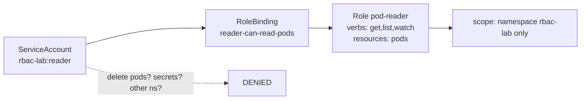

# Module 12 — Security & RBAC

## 🎯 What you'll learn

- Use **namespaces** to isolate and scope resources.
- Explain **ServiceAccounts** (an identity for pods/clients) vs human users.
- Build **least-privilege** access with a **Role** + **RoleBinding**, and how
  that differs from **ClusterRole** / **ClusterRoleBinding**.
- Verify permissions fast with `kubectl auth can-i`.

## 🐳 Docker bridge

Docker has no built-in multi-tenant authorization — if you can reach the daemon,
you can do anything. Kubernetes ships **RBAC**: every request to the API server
is checked against rules that say *who* (subject) can do *what* (verbs) to
*which* resources, in *which* namespace. This is how teams safely share one
cluster.

## 🧠 Concept

**Namespaces** partition a cluster: names are unique *within* a namespace, and
RBAC/quotas/network policies can be scoped to one. Think "virtual clusters" for
teams or environments. (You've been working in `default`.)

**Identities (subjects):**
- **Users** — humans (managed outside k8s: certs, OIDC, etc.).
- **ServiceAccounts** — identities **for workloads**. Every pod runs as one
  (the namespace's `default` SA unless you set `serviceAccountName`).

**Permissions = Role + Binding:**
- A **Role** is a list of `rules`: `verbs` (get/list/watch/create/update/delete)
  × `resources` (pods, services, …) — **scoped to one namespace**.
- A **RoleBinding** grants a Role to **subjects** (users, groups, SAs).
- **ClusterRole** / **ClusterRoleBinding** are the cluster-wide versions (for
  cluster resources like nodes, or to grant the same Role across all namespaces).

```
Subject (ServiceAccount reader)
   └── RoleBinding  --grants-->  Role (pod-reader: get/list pods)
                                   scope = namespace rbac-lab
```

**Least privilege:** grant only the verbs/resources actually needed, in the
narrowest scope. Avoid binding `cluster-admin` to everything.

**`kubectl auth can-i`** answers "is this allowed?" without trial and error —
including impersonation with `--as`.

## 📊 Diagram



## 📋 Cheatsheet

```bash
# --- namespaces ---
kubectl get namespaces
kubectl get pods -n rbac-lab
kubectl config set-context --current --namespace=rbac-lab   # default ns for your commands

# --- inspect RBAC ---
kubectl get serviceaccount,role,rolebinding -n rbac-lab
kubectl describe role pod-reader -n rbac-lab

# --- the permission oracle ---
kubectl auth can-i list pods -n rbac-lab                       # as YOU
kubectl auth can-i delete pods --as=system:serviceaccount:rbac-lab:reader -n rbac-lab
kubectl auth can-i --list --as=system:serviceaccount:rbac-lab:reader -n rbac-lab

# --- create imperatively (prints YAML) ---
kubectl create role pod-reader --verb=get,list,watch --resource=pods -n rbac-lab --dry-run=client -o yaml
kubectl create rolebinding reader-rb --role=pod-reader --serviceaccount=rbac-lab:reader -n rbac-lab --dry-run=client -o yaml
```

## 🧪 Practice

> Run on `kind-k8s-course`; paste output as you go. The SA name format is
> `system:serviceaccount:<namespace>:<name>`.

**Step 1 — Create the namespace, SA, Role, and RoleBinding.**
```bash
kubectl apply -f manifests/12-security-rbac/
kubectl get serviceaccount,role,rolebinding -n rbac-lab
```

**Step 2 — Confirm the granted permission (should be yes).**
```bash
kubectl auth can-i list pods --as=system:serviceaccount:rbac-lab:reader -n rbac-lab
```
Expected: `yes`.

**Step 3 — Confirm a denied verb (should be no).**
```bash
kubectl auth can-i delete pods --as=system:serviceaccount:rbac-lab:reader -n rbac-lab
```
Expected: `no` — the Role only granted get/list/watch.

**Step 4 — Confirm namespace scoping (should be no).**
```bash
kubectl auth can-i list pods --as=system:serviceaccount:rbac-lab:reader -n default
```
Expected: `no` — a Role is namespaced, so it grants nothing in `default`.

**Step 5 — Confirm resource scoping (should be no).**
```bash
kubectl auth can-i list secrets --as=system:serviceaccount:rbac-lab:reader -n rbac-lab
```
Expected: `no` — only `pods` were granted, not `secrets`.

**Step 6 — See everything the SA can do.**
```bash
kubectl auth can-i --list --as=system:serviceaccount:rbac-lab:reader -n rbac-lab
```
Expected: a short list including `pods [get list watch]` (plus default
self-review permissions).

**Step 7 — Clean up.**
```bash
kubectl delete -f manifests/12-security-rbac/
```

## ✅ Check yourself

You should now be able to:

- [ ] Explain namespaces and ServiceAccounts.
- [ ] Build a least-privilege Role + RoleBinding.
- [ ] Predict the result of `auth can-i` for a verb/resource/namespace.
- [ ] Say when you'd use ClusterRole vs Role.

**Challenge:** Without the cheatsheet, grant the same `reader` SA the ability to
also **list services** in `rbac-lab` (edit `role.yaml` to add a rule for
`services`, re-apply), then prove it with `auth can-i list services
--as=...`. What's the smallest change that grants exactly that and nothing more?

## 🐛 Common gotchas

- **Every pod gets a ServiceAccount** — the namespace `default` SA unless you set
  `serviceAccountName`. Don't accidentally give `default` broad rights.
- **Role vs ClusterRole scope** — a Role grants only within its namespace; for
  cluster-scoped resources (nodes, PVs) or all-namespace grants you need a
  ClusterRole.
- **Binding subject must match exactly** — `kind`, `name`, and `namespace` of the
  ServiceAccount in the RoleBinding must be correct, or it silently grants
  nothing.
- **`cluster-admin` is a loaded gun** — binding it widely defeats RBAC. Grant the
  narrowest role that works.
- **Secrets are readable with `get secret`** — RBAC is how you keep that locked
  down (ties back to Module 6).
