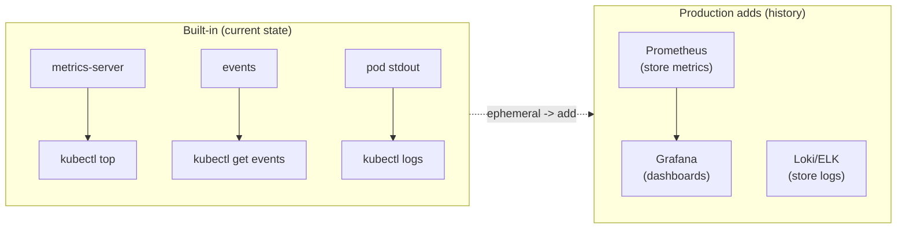

# Module 13 — Observability

## 🎯 What you'll learn

- Read live resource usage with **`kubectl top`** (nodes and pods).
- Use **events** and `describe` for a cluster-state view over time.
- Understand the gap k8s leaves — metrics/logs are **ephemeral** — and what
  Prometheus / Grafana / Loki add (conceptually; no full install here).
- Spot resource-pressure signals (allocations near capacity, OOM, evictions).

## 🐳 Docker bridge

`docker stats` shows live CPU/mem for containers on **one host**. Kubernetes
spreads workloads across nodes, so you need a **cluster-wide** view:
`kubectl top` (powered by metrics-server) plus the events stream. For history and
alerting, production clusters add external systems (Prometheus for metrics,
Grafana for dashboards, Loki/ELK for logs) — because k8s itself keeps only
*current* data.

## 🧠 Concept

Observability in k8s has three pillars; this module focuses on the built-ins and
points at the rest:

1. **Metrics (now)** — `kubectl top nodes` / `top pods` show current CPU/memory,
   served by **metrics-server** (installed in Module 9). Great for "what's hot
   right now", not for history.
2. **Events (recent)** — every object emits events (scheduled, pulled, started,
   failed, killed). `kubectl get events --sort-by=.lastTimestamp` and the Events
   section of `kubectl describe` are your timeline — but events **expire** (~1h).
3. **Logs (ephemeral)** — `kubectl logs` shows a container's stdout/stderr, but
   logs **vanish when the pod is deleted**. That's why real clusters ship logs to
   an aggregator.

**The production gap:** because metrics/events/logs are all short-lived, you add:
- **Prometheus** — scrapes & stores metrics over time (history, alerting).
- **Grafana** — dashboards on top of Prometheus.
- **Loki / ELK** — centralized, searchable, persistent logs.

You don't install those here — but knowing *why* they exist (k8s keeps only
current state) is the work-ready insight.

**Resource pressure** — `kubectl describe node` shows **Requests vs Capacity**.
When requests approach capacity, new pods go `Pending`; memory pressure triggers
**evictions**; over-limit containers get **OOMKilled**. Watching allocations is
how you see trouble coming.

## 📊 Diagram



## 📋 Cheatsheet

```bash
# --- live usage (needs metrics-server) ---
kubectl top nodes
kubectl top pods                       # current namespace
kubectl top pods -A                    # all namespaces
kubectl top pods -l app=sample --sort-by=cpu

# --- events timeline ---
kubectl get events --sort-by=.lastTimestamp
kubectl get events -A --sort-by=.lastTimestamp
kubectl describe pod NAME              # per-object events at the bottom

# --- capacity / pressure ---
kubectl describe node NODE | grep -A8 "Allocated resources"
kubectl get pods -A --field-selector=status.phase=Pending   # unschedulable = pressure?
```

## 🧪 Practice

> Run on `kind-k8s-course`. Requires metrics-server (installed in Module 9). If
> `kubectl top` errors, redo Module 9 Step 1.

**Step 1 — Deploy a small workload to observe.**
```bash
kubectl apply -f manifests/13-observability/sample.yaml
kubectl rollout status deploy/sample
```

**Step 2 — Live usage per node and per pod.**
```bash
kubectl top nodes
kubectl top pods -l app=sample
```
Expected: a node row with CPU%/MEM%, and three `sample-*` pods each showing a few
milli-cores and ~24Mi.

**Step 3 — The events timeline.**
```bash
kubectl get events --sort-by=.lastTimestamp
```
Expected: recent `Scheduled` / `Pulled` / `Created` / `Started` lines for the
sample pods — the story of what just happened, in order.

**Step 4 — Capacity vs allocation (pressure view).**
```bash
kubectl describe node k8s-course-control-plane | findstr /C:"Allocated resources" /C:"cpu" /C:"memory"
```
Expected: `Requests` and `Limits` totals vs the node's capacity (small % on a
fresh cluster). This is how you see how full a node is.

**Step 5 — Sort pods by CPU (find the hog).**
```bash
kubectl top pods -A --sort-by=cpu
```
Expected: all pods cluster-wide, busiest CPU first (system pods usually top).

**Step 6 — Clean up.**
```bash
kubectl delete -f manifests/13-observability/
```

## ✅ Check yourself

You should now be able to:

- [ ] Read `kubectl top` for nodes and pods.
- [ ] Use the events timeline to reconstruct what happened.
- [ ] Read a node's allocated-vs-capacity and reason about pressure.
- [ ] Explain why production adds Prometheus/Grafana/Loki.

**Challenge:** Without metrics history, you can't see a *spike that already
ended*. Describe (in one or two sentences) what you'd lose by relying only on
`kubectl top`, and which tool fixes it. (This is the "why Prometheus" answer
interviewers like.)

## 🐛 Common gotchas

- **`kubectl top` errors** → metrics-server missing/not ready, or (on kind) the
  `--kubelet-insecure-tls` patch wasn't applied (Module 9).
- **Events disappear** → they're retained ~1h; don't rely on them for history.
- **Logs die with the pod** → `kubectl logs` can't show a deleted pod's output;
  that's why you ship logs off-cluster.
- **`top` is a snapshot** → it shows *current* usage, not trends; a past spike is
  invisible without a metrics store.
- **Requests, not usage, drive scheduling** → a node can look "busy" by requests
  while actual `top` usage is low (over-requesting). Compare both.
