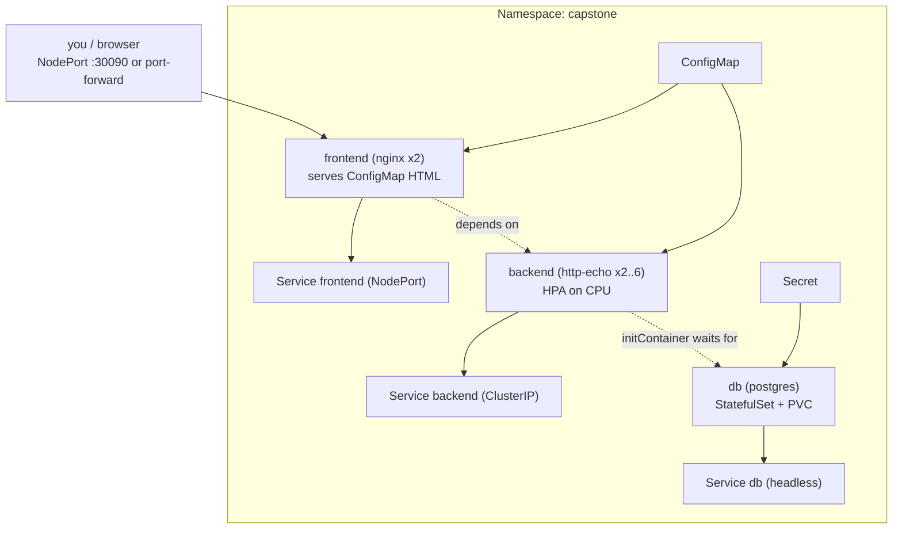

# Module 14 — Capstone (multi-tier app, end-to-end)

## 🎯 What you'll learn

This module doesn't teach a new object — it **combines everything**. You'll
deploy a three-tier app (**frontend → backend → database**) into its own
namespace with **one command**, then operate it:

- Deploy with **Kustomize** (`kubectl apply -k`).
- Wire **config** (ConfigMap) and **secrets** (Secret) into the tiers.
- Persist the DB with a **StatefulSet + PVC**, gate traffic with **probes**,
  enforce **dependency ordering** with an initContainer.
- **Expose** via NodePort, **autoscale** the backend with an **HPA**.
- **Scale**, **debug a failure**, and **roll back** — the day-job loop.

## 🐳 Docker bridge

This is your `docker-compose.yml` for a real app — but every piece is now
self-healing, scalable, probed, and versioned. Compose brings containers up;
Kubernetes keeps the whole system in its desired state and gives you rollouts,
rollbacks, and autoscaling on top.

## 🧠 Concept — how the pieces from Modules 1–13 fit

| Tier / concern | Object | Module |
|----------------|--------|--------|
| Isolation | **Namespace** `capstone` | 12 |
| DB credentials | **Secret** `db-secret` | 6 |
| App config + frontend HTML | **ConfigMap** `app-config` | 6 |
| Database | **StatefulSet** `db` + PVC + headless Service | 7 |
| DB readiness | `pg_isready` **exec probe** | 11 |
| Backend | **Deployment** `backend` + **Service** | 3, 5 |
| Start ordering | **initContainer** waits for `db:5432` | 2, 10 |
| Backend health | **readiness/liveness** probes | 11 |
| Autoscale backend | **HPA** (CPU 60%) | 9 |
| Frontend | **Deployment** + **NodePort Service** | 3, 5 |
| One-command deploy | **Kustomize** `kustomization.yaml` | new |

**Dependency ordering done right:** the backend's **initContainer** blocks until
the database accepts connections (`nc -z db 5432`). So even though
`kubectl apply -k` creates everything at once, the backend pods don't go Ready
until the DB is actually up — no fragile sleeps, just real readiness.

**Why a namespace:** everything lives in `capstone`, so cleanup is a single
`kubectl delete -k` (or `kubectl delete ns capstone`) — and PVCs go with it.

## 📊 Diagram



## 📋 Cheatsheet

```bash
# --- deploy / inspect / tear down the whole app ---
kubectl apply -k manifests/14-capstone/
kubectl get all,pvc,cm,secret,hpa -n capstone
kubectl wait --for=condition=ready pod --all -n capstone --timeout=180s
kubectl delete -k manifests/14-capstone/          # one-command teardown

# --- reach it ---
kubectl port-forward -n capstone svc/frontend 8080:80     # http://localhost:8080
kubectl run tmp -n capstone --image=curlimages/curl --restart=Never -i --rm -- -s http://backend

# --- operate ---
kubectl scale -n capstone deploy/backend --replicas=4
kubectl set image -n capstone deploy/backend backend=hashicorp/http-echo:badtag   # break it
kubectl rollout status -n capstone deploy/backend
kubectl rollout undo  -n capstone deploy/backend                                  # recover
```

## 🧪 Practice

> Run on `kind-k8s-course`. Requires metrics-server (Module 9) for the HPA.
> Paste output as you go.

**Step 1 — Deploy the whole stack with one command.**
```bash
kubectl apply -k manifests/14-capstone/
kubectl wait --for=condition=ready pod --all -n capstone --timeout=180s
kubectl get all,pvc,cm,secret,hpa -n capstone
```
Expected: `db-0` (1/1), `backend` 2/2, `frontend` 2/2, a Bound PVC `data-db-0`,
and the `backend` HPA. Notice the backend only became Ready after the DB —
that's the initContainer.

**Step 2 — Watch the dependency ordering (optional, re-deploy to see it).**
```bash
kubectl get pods -n capstone -w
```
On a fresh apply you'll see backend pods sit in `Init:0/1` until `db-0` is Ready,
then flip to `Running`. Ctrl+C when done.

**Step 3 — Reach the app.**
```bash
kubectl port-forward -n capstone svc/frontend 8080:80
```
Open `http://localhost:8080` → the Capstone HTML page (served from the
ConfigMap). Ctrl+C to stop. Backend check:
```bash
kubectl run tmp -n capstone --image=curlimages/curl --restart=Never -i --rm -- -s http://backend
```
Expected: `backend v1 — hello from the API tier` (the ConfigMap value).

**Step 4 — Scale the backend.**
```bash
kubectl scale -n capstone deploy/backend --replicas=4
kubectl get pods -n capstone -l app=backend
```
Expected: 4 backend pods.

**Step 5 — Break it, diagnose, roll back (the real drill).**
```bash
kubectl set image -n capstone deploy/backend backend=hashicorp/http-echo:badtag
kubectl get pods -n capstone -l app=backend          # new pod ImagePullBackOff
kubectl run tmp -n capstone --image=curlimages/curl --restart=Never -i --rm -- -s http://backend
```
Expected: the new pod fails to pull, but the **old** pods keep serving (rolling
update + readiness = zero downtime). Now recover:
```bash
kubectl rollout undo -n capstone deploy/backend
kubectl rollout status -n capstone deploy/backend
```

**Step 6 — One-command teardown.**
```bash
kubectl delete -k manifests/14-capstone/
kubectl get ns capstone
```
Expected: the namespace (and everything in it, including the PVC) is removed.

## ✅ Check yourself — the course success criteria

You can now, on a real cluster:

- [ ] Deploy a multi-tier app end-to-end and expose it.
- [ ] Wire config + secrets and persist a database.
- [ ] Scale a tier and autoscale it on load.
- [ ] Diagnose a failing rollout from pods/events and roll it back.
- [ ] Reason about ordering, health, storage, and namespaced cleanup.

**Final challenge:** Promote the backend to "v2" the *right* way: change
`BACKEND_MESSAGE` in `configmap.yaml` to `backend v2 ...`, re-apply with
`kubectl apply -k`, then **`kubectl rollout restart -n capstone deploy/backend`**
(remember: env from a ConfigMap needs a restart — Module 6). Confirm the backend
now returns v2. Why didn't the message change on `apply` alone?

## 🐛 Common gotchas

- **Apply order doesn't guarantee start order** — use initContainers/readiness
  for real dependencies; don't assume the DB is up because it was applied first.
- **DB Secret must exist before the DB pod mounts it** — Kustomize applies them
  together, but a typo'd `secretKeyRef` leaves the pod stuck.
- **HPA `<unknown>` at first** — metrics take ~30s to populate; it settles to
  `x%/60%`. Needs metrics-server.
- **NodePort on kind** — `30090` isn't published to Windows; use `port-forward`.
- **Deleting the namespace deletes its PVCs** — convenient here, but in
  production that destroys data. Know what your cleanup removes.
- **ConfigMap env change needs a restart** — `apply` updates the ConfigMap, but
  running pods keep the old env until `rollout restart` (Module 6).
