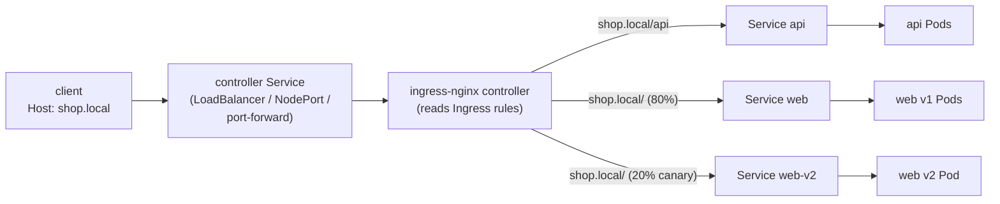

# Module 15 — Ingress (HTTP routing into the cluster)

## 🎯 What you'll learn

- Why a Service alone isn't how real apps are exposed: one **Ingress** gives you
  many apps behind **one entry point**, routed by **hostname and path**.
- **Ingress resource vs Ingress controller**: the YAML is just a rule; a
  controller (here **ingress-nginx**) is the actual reverse proxy that obeys it.
- **TLS termination** at the Ingress using a `kubernetes.io/tls` Secret.
- An **exact-percentage canary** with ingress-nginx annotations — the thing
  Module 4 said "needs an Ingress".
- Where **Gateway API** fits (the successor to Ingress).

## 🐳 Docker bridge

In a Docker setup you'd put **nginx or Traefik in front** of your containers:
`shop.local/` → web container, `shop.local/api` → api container, TLS certs on
the proxy. An Ingress is exactly that — except you describe the routes as
Kubernetes objects and the controller rewrites its own config whenever Pods or
rules change.

| | Docker + reverse proxy | Kubernetes |
|---|------------------------|------------|
| The proxy | nginx/Traefik container you configure | **Ingress controller** (a Deployment) |
| Routing rules | `nginx.conf` / Traefik labels | **Ingress** objects |
| Backends | container names | **Services** (→ Endpoints → Pods) |
| TLS certs | files mounted into the proxy | **TLS Secret** referenced by the Ingress |

## 🧠 Concept

**The problem.** Module 5 gave you NodePort and LoadBalancer. But a
LoadBalancer per app means one cloud LB (and one bill, one IP) per Service, and
NodePorts are ugly high ports. In production you usually want **one** public
entry point that fans out to many Services by HTTP host/path.

**Two separate pieces — this trips everyone up:**

1. **Ingress (resource)** — a YAML rule: "host `shop.local`, path `/api` → Service
   `api` port 80". On its own it does **nothing**.
2. **Ingress controller** — a real proxy (ingress-nginx, Traefik, HAProxy, cloud
   ALB…) running in the cluster. It watches Ingress objects and configures
   itself. The controller itself is exposed with **one** LoadBalancer/NodePort.

`spec.ingressClassName` says which controller should handle a rule (a cluster
can run several).

**Routing.** Each rule matches a `host` (optional) and a list of `paths`.
`pathType: Prefix` matches by path segments (`/api` matches `/api` and
`/api/users`, not `/apiv2`); `Exact` matches one path only. The **most specific
match wins**, so `/api` beats `/`.

**TLS termination.** Put a cert + key in a Secret of type `kubernetes.io/tls`,
list it under `spec.tls`, and the controller serves HTTPS for that host. Traffic
from the controller to your Pods stays plain HTTP inside the cluster. In real
clusters **cert-manager** creates and renews these Secrets automatically
(e.g. from Let's Encrypt).

**Controller-specific features live in annotations.** Rewrites, rate limits,
body size, auth, **canary** — the Ingress spec doesn't cover these, so each
controller adds its own `annotations`. That's why Ingress YAML isn't fully
portable between controllers.

**Gateway API — the successor.** Ingress is frozen: stable, everywhere, but no
new features. **Gateway API** (`Gateway` + `HTTPRoute` objects) is the modern
replacement, with traffic splitting, header matching, and cross-namespace
routing built into the spec instead of annotations. Note: the community
**ingress-nginx** controller was **retired in March 2026** (no more security
fixes). It's still fine for learning the Ingress model locally, and you'll see
Ingress objects at almost every job — but new platforms pick a Gateway API
implementation (Envoy Gateway, Cilium, Istio, NGINX Gateway Fabric, Traefik).
The same canary in Gateway API looks like:

```yaml
apiVersion: gateway.networking.k8s.io/v1
kind: HTTPRoute
metadata: { name: shop }
spec:
  parentRefs: [{ name: my-gateway }]
  hostnames: ["shop.local"]
  rules:
    - backendRefs:
        - { name: web,    port: 80, weight: 80 }
        - { name: web-v2, port: 80, weight: 20 }
```

## 📊 Diagram



One entry point → many Services, chosen by host + path (+ canary weight).

## 📋 Cheatsheet

```bash
# --- install ingress-nginx on kind ---
kubectl label node k8s-course-control-plane ingress-ready=true
kubectl apply -f https://raw.githubusercontent.com/kubernetes/ingress-nginx/controller-v1.12.1/deploy/static/provider/kind/deploy.yaml
kubectl wait -n ingress-nginx --for=condition=ready pod \
  --selector=app.kubernetes.io/component=controller --timeout=180s

# --- inspect ---
kubectl get ingressclass                 # which controllers exist
kubectl get ingress                      # HOSTS, ADDRESS, PORTS
kubectl describe ingress shop            # rules -> backends (+ endpoints)
kubectl logs -n ingress-nginx deploy/ingress-nginx-controller   # access log

# --- reach it locally (no DNS / port mapping needed) ---
kubectl port-forward -n ingress-nginx svc/ingress-nginx-controller 8080:80 8443:443
curl --resolve shop.local:8080:127.0.0.1 http://shop.local:8080/
curl -H "Host: shop.local" http://localhost:8080/api       # same idea

# --- TLS ---
kubectl create secret tls shop-tls --cert=tls.crt --key=tls.key
curl -k --resolve shop.local:8443:127.0.0.1 https://shop.local:8443/
```

```yaml
# Ingress skeleton
spec:
  ingressClassName: nginx
  tls: [{ hosts: [shop.local], secretName: shop-tls }]   # optional
  rules:
    - host: shop.local
      http:
        paths:
          - { path: /api, pathType: Prefix, backend: { service: { name: api, port: { number: 80 } } } }

# ingress-nginx canary (on a SECOND Ingress for the same host/path)
metadata:
  annotations:
    nginx.ingress.kubernetes.io/canary: "true"
    nginx.ingress.kubernetes.io/canary-weight: "20"
    nginx.ingress.kubernetes.io/canary-by-header: "X-Canary"   # "always" -> canary
```

## 🧪 Practice

> Run on `kind-k8s-course`; paste output as you go. Keep the port-forward from
> Step 2 running in its own terminal for the rest of the lab.

**Step 1 — Install the controller.**
```bash
kubectl label node k8s-course-control-plane ingress-ready=true
kubectl apply -f https://raw.githubusercontent.com/kubernetes/ingress-nginx/controller-v1.12.1/deploy/static/provider/kind/deploy.yaml
kubectl wait -n ingress-nginx --for=condition=ready pod --selector=app.kubernetes.io/component=controller --timeout=180s
kubectl get ingressclass
```
Expected: `condition met`, and an IngressClass named `nginx`. The label is
needed because the kind flavour of the manifest only schedules the controller on
nodes labelled `ingress-ready=true`.

**Step 2 — Open the front door.** In a **second terminal**:
```bash
kubectl port-forward -n ingress-nginx svc/ingress-nginx-controller 8080:80 8443:443
```
Back in the first terminal:
```bash
curl -s -o /dev/null -w "HTTP %{http_code}\n" --resolve shop.local:8080:127.0.0.1 http://shop.local:8080/
```
Expected: `HTTP 404`. The controller is answering — it just has no rules yet.
That 404 comes from nginx, not from your app.

**Step 3 — Backends + one Ingress, two paths.**
```bash
kubectl apply -f manifests/15-ingress/apps.yaml -f manifests/15-ingress/ingress.yaml
kubectl rollout status deploy/web && kubectl rollout status deploy/api
kubectl get ingress shop
curl --resolve shop.local:8080:127.0.0.1 http://shop.local:8080/
curl --resolve shop.local:8080:127.0.0.1 http://shop.local:8080/api
curl --resolve shop.local:8080:127.0.0.1 http://shop.local:8080/api/users
```
Expected: `web v1`, then `api`, then `api` again (`Prefix` matches sub-paths).
One entry point, routed by path.

**Step 4 — Host matters.**
```bash
curl -s -o /dev/null -w "HTTP %{http_code}\n" -H "Host: other.local" http://localhost:8080/
```
Expected: `HTTP 404` — no rule for that host. Ingress routes on the HTTP `Host`
header, which is why plain `curl http://localhost:8080` doesn't reach your app.

**Step 5 — Exact-percentage canary.**
```bash
kubectl apply -f manifests/15-ingress/canary.yaml
kubectl rollout status deploy/web-v2
for i in $(seq 1 50); do curl -s --resolve shop.local:8080:127.0.0.1 http://shop.local:8080/; done | sort | uniq -c
```
Expected: roughly **40 × `web v1`** and **10 × `web v2 (canary)`** — 20%, even
though v1 has 2 replicas and v2 has 1. Now force the canary with the header:
```bash
curl -H "X-Canary: always" --resolve shop.local:8080:127.0.0.1 http://shop.local:8080/
```
Expected: `web v2 (canary)` every time. Promote = bump `canary-weight` to `100`,
then point the main Ingress at v2 and delete the canary.

**Step 6 — HTTPS with a self-signed cert.** (Needs `openssl`; on Windows use Git
Bash.)
```bash
openssl req -x509 -nodes -days 30 -newkey rsa:2048 -keyout tls.key -out tls.crt -subj "/CN=shop.local" -addext "subjectAltName=DNS:shop.local"
kubectl create secret tls shop-tls --cert=tls.crt --key=tls.key
kubectl apply -f manifests/15-ingress/ingress-tls.yaml
curl -k --resolve shop.local:8443:127.0.0.1 https://shop.local:8443/api
curl -kv --resolve shop.local:8443:127.0.0.1 https://shop.local:8443/ 2>&1 | grep "subject:"
```
Expected: `api`, and the cert subject shows `CN=shop.local` — your cert, not
the controller's default "Kubernetes Ingress Controller Fake Certificate".
(`-k` skips trust checks because it's self-signed.) Delete the local key files:
`rm tls.key tls.crt`.

**Step 7 — Clean up.** Stop the port-forward (Ctrl+C), then:
```bash
kubectl delete -f manifests/15-ingress/
kubectl delete secret shop-tls
```
Leave the controller installed if you want to reuse it; otherwise
`kubectl delete -f https://raw.githubusercontent.com/kubernetes/ingress-nginx/controller-v1.12.1/deploy/static/provider/kind/deploy.yaml`.

## ✅ Check yourself

You should now be able to:

- [ ] Explain the difference between an Ingress and an Ingress controller.
- [ ] Route two Services from one host by path, and say why `/api` beats `/`.
- [ ] Terminate TLS at the Ingress from a TLS Secret.
- [ ] Run a weighted canary and force it with a header.
- [ ] Say what Gateway API is and why new platforms use it instead of Ingress.

**Challenge:** Without the cheatsheet, expose the capstone (Module 14) through
the Ingress: deploy it with `kubectl apply -k manifests/14-capstone/`, then
write an Ingress in namespace `capstone` for host `capstone.local` → Service
`frontend` port 80, and curl it through the controller. (Hint: an Ingress can
only point at Services in **its own** namespace.)

## 🐛 Common gotchas

- **Ingress created, nothing happens / no ADDRESS** → no controller installed,
  or `ingressClassName` doesn't match one (`kubectl get ingressclass`).
- **404 from nginx** → the request's `Host` header or path doesn't match any
  rule. Curling `localhost` without `--resolve`/`-H Host:` is the usual cause.
- **503 from nginx** → the rule matched but the backend Service has **no ready
  Endpoints** (selector mismatch, failing readiness probe). Same debugging as
  Module 5: `kubectl get endpoints <svc>`.
- **Backend in another namespace** → not allowed. The Ingress and its Services
  must share a namespace (Gateway API can cross namespaces with ReferenceGrant).
- **"Fake Certificate" served** → the TLS Secret name is wrong, it's in another
  namespace, or the cert's SAN doesn't cover the host.
- **Annotations ignored** → they're controller-specific. An
  `nginx.ingress.kubernetes.io/*` annotation does nothing on Traefik or a cloud
  ALB.
- **Controller Pod Pending on kind** → you forgot the `ingress-ready=true` node
  label.
