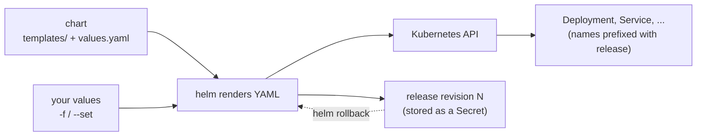

# Module 16 — Helm (packaging & installing apps)

## 🎯 What you'll learn

- What a **chart**, a **release**, and **values** are — and why most
  third-party software (databases, ingress controllers, monitoring) is installed
  with Helm.
- The release lifecycle: `install` → `upgrade` → `history` → `rollback` →
  `uninstall`.
- How to **override values** (`-f values.yaml`, `--set`) and **see the YAML
  Helm will apply** before it touches the cluster (`helm template`, `--dry-run`).
- How templating works inside a chart (`{{ .Values.x }}`), using `helm create`.
- **Helm vs Kustomize** (Module 14) — when to reach for which.

## 🐳 Docker bridge

Think `docker run` with a *pre-written `docker-compose.yml` you can customise
without editing*. Someone else maintains the compose file for Postgres or
Prometheus; you just pass your settings. Helm is that for Kubernetes: the chart
author writes templated YAML, you supply values.

| | Docker world | Helm |
|---|-------------|------|
| Reusable package | image + compose file | **chart** (templates + default values) |
| Where packages live | Docker Hub | chart **repository** / OCI registry |
| Your settings | `.env` / compose overrides | **values** (`-f my-values.yaml`, `--set`) |
| One running copy | a compose project | a **release** (named install of a chart) |
| Upgrade / go back | re-pull, re-up | `helm upgrade` / `helm rollback` |

## 🧠 Concept

**Chart.** A directory (or packaged `.tgz`) with:

```
mychart/
  Chart.yaml        # name, version, appVersion
  values.yaml       # default settings
  templates/        # Kubernetes YAML with {{ }} placeholders
    deployment.yaml
    service.yaml
    _helpers.tpl    # reusable named snippets (names, labels)
```

**Templating.** Helm renders `templates/` with Go templates, filling in values:

```yaml
# templates/deployment.yaml (excerpt)
spec:
  replicas: {{ .Values.replicaCount }}
  template:
    spec:
      containers:
        - image: "{{ .Values.image.repository }}:{{ .Values.image.tag }}"
```

`values.yaml` has `replicaCount: 1`; you install with `--set replicaCount=3`
and the rendered Deployment says `replicas: 3`. Override priority, lowest to
highest: chart `values.yaml` → each `-f file.yaml` (in order) → `--set`.

**Release.** `helm install demo podinfo/podinfo` creates a release named `demo`.
Helm records each install/upgrade as a numbered **revision** (stored as a
Secret in the release's namespace), which is what makes `helm rollback` work.
Resource names usually include the release name (`demo-podinfo`), so you can
install the same chart twice side by side.

**Helm only manages what it rendered.** `kubectl edit` on a Helm-owned object
works, but the next `helm upgrade` overwrites it. Change values, not live
objects.

**Helm vs Kustomize.**

| | Helm | Kustomize |
|---|------|-----------|
| Model | templates + values | plain YAML + patches/overlays |
| Best for | installing **other people's** software; parameterised apps | **your own** app across dev/stage/prod |
| Release history / rollback | yes (`helm history/rollback`) | no (use git) |
| Built into kubectl | no | yes (`kubectl apply -k`) |

Common combo at work: Helm for third-party charts, Kustomize (or plain YAML)
for your own services, all driven by GitOps (Module 20).

## 📊 Diagram



## 📋 Cheatsheet

```bash
# --- install helm ---
brew install helm            # macOS
winget install Helm.Helm     # Windows
helm version

# --- find & inspect charts ---
helm repo add podinfo https://stefanprodan.github.io/podinfo
helm repo update
helm search repo podinfo
helm show values podinfo/podinfo | less      # every knob + defaults

# --- preview before installing ---
helm template demo podinfo/podinfo -f values.yaml          # render YAML locally
helm install demo podinfo/podinfo -f values.yaml --dry-run # render + validate vs API

# --- release lifecycle ---
helm install demo podinfo/podinfo -n NS --create-namespace -f values.yaml
helm list -n NS                              # releases, REVISION, STATUS
helm upgrade demo podinfo/podinfo -n NS -f values.yaml --set replicaCount=3
helm upgrade --install demo podinfo/podinfo -n NS -f values.yaml   # idempotent (CI)
helm history demo -n NS
helm rollback demo 1 -n NS
helm get values demo -n NS                   # what YOU set
helm get manifest demo -n NS                 # what was applied
helm uninstall demo -n NS

# --- write your own ---
helm create mychart
helm lint mychart
helm template t ./mychart --set replicaCount=3 | grep replicas
```

## 🧪 Practice

> Run on `kind-k8s-course`; paste output as you go.

**Step 1 — Install Helm and add a repo.**
```bash
helm version
helm repo add podinfo https://stefanprodan.github.io/podinfo
helm repo update
helm search repo podinfo
```
Expected: a `version.BuildInfo{Version:"v3...` (or v4) line, and
`podinfo/podinfo` listed with a CHART VERSION and APP VERSION.

**Step 2 — Read the knobs before turning them.**
```bash
helm show values podinfo/podinfo | grep -E "^replicaCount|^ui:" -A3
cat manifests/16-helm/podinfo-values.yaml
```
Expected: the chart defaults (`replicaCount: 1`, `ui.message: ""`…) and our
overrides file. Only what we list changes.

**Step 3 — Preview the rendered YAML.**
```bash
helm template demo podinfo/podinfo -f manifests/16-helm/podinfo-values.yaml | grep -E "^kind:|replicas:|PODINFO_UI"
```
Expected: `kind: Service`, `kind: Deployment`, `replicas: 2`, and the
`PODINFO_UI_MESSAGE` env var. Nothing has been sent to the cluster yet.

**Step 4 — Install a release.**
```bash
helm install demo podinfo/podinfo -n helm-lab --create-namespace -f manifests/16-helm/podinfo-values.yaml
helm list -n helm-lab
kubectl get deploy,svc,pods -n helm-lab
```
Expected: release `demo`, `REVISION 1`, `STATUS deployed`; a Deployment and
Service named `demo-podinfo` with 2 Pods. Open it:
```bash
kubectl port-forward -n helm-lab svc/demo-podinfo 9898:9898
```
Browse http://localhost:9898 → the blue page says "Deployed with Helm". Ctrl+C.

**Step 5 — Upgrade, then roll back.**
```bash
helm upgrade demo podinfo/podinfo -n helm-lab -f manifests/16-helm/podinfo-values.yaml --set replicaCount=3 --set ui.message="v2 via upgrade"
kubectl get pods -n helm-lab
helm history demo -n helm-lab
helm rollback demo 1 -n helm-lab
helm history demo -n helm-lab
kubectl get pods -n helm-lab
```
Expected: 3 Pods after upgrade; history shows revisions 1 and 2; after rollback
a **new revision 3** ("Rollback to 1") and back to 2 Pods. Rollback moves
forward in history, like `kubectl rollout undo` did in Module 3.

**Step 6 — Prove that values beat live edits.**
```bash
kubectl scale deploy demo-podinfo -n helm-lab --replicas=5
helm upgrade demo podinfo/podinfo -n helm-lab -f manifests/16-helm/podinfo-values.yaml
kubectl get deploy demo-podinfo -n helm-lab
```
Expected: back to `2/2`. The manual scale was drift; the next upgrade
re-applied what the values say.

**Step 7 — Look inside a chart.** In a scratch folder **outside this repo**:
```bash
helm create mychart
ls mychart mychart/templates
grep -n "replicaCount" mychart/values.yaml mychart/templates/deployment.yaml
helm lint mychart
helm template t ./mychart --set replicaCount=4 | grep "replicas:"
```
Expected: the chart layout from the Concept section, `replicaCount` defined in
`values.yaml` and used as `{{ .Values.replicaCount }}` in the template, lint
`0 chart(s) failed`, and `replicas: 4`.

**Step 8 — Clean up.**
```bash
helm uninstall demo -n helm-lab
kubectl delete namespace helm-lab
```
Delete the scratch `mychart/` folder too.

## ✅ Check yourself

You should now be able to:

- [ ] Define chart, release, revision, and values.
- [ ] Install a public chart with your own values file.
- [ ] Preview rendered YAML before applying it.
- [ ] Upgrade, inspect history, and roll back a release.
- [ ] Explain why `kubectl edit` on a Helm-managed object doesn't stick.
- [ ] Choose between Helm and Kustomize for a given job.

**Challenge:** Reinstall the Module 15 ingress controller **with Helm** instead
of a raw manifest: add repo `https://kubernetes.github.io/ingress-nginx`, find
the chart, read its values, and install release `ingress` into namespace
`ingress-nginx` with `controller.replicaCount=2`. Prove it with `helm list -A`
and `kubectl get pods -n ingress-nginx`. (Delete the Module 15 manifest-based
install first, or the two will fight over the same names.)

## 🐛 Common gotchas

- **`cannot re-use a name that is still in use`** → a release with that name
  already exists in that namespace. Use `helm upgrade --install`, or pick a new
  name.
- **Forgot `-n`** → Helm defaults to your current namespace; `helm list` shows
  nothing because the release is elsewhere. Use `helm list -A`.
- **Upgrade silently dropped your settings** → `helm upgrade` without `-f`
  starts again from chart defaults. Pass your values file on **every** upgrade
  (or use `--reuse-values` carefully).
- **`--set` with commas/dots** → `--set a.b=c` sets nested keys; values with
  commas need escaping. Prefer a values file for anything non-trivial.
- **Typo in a value key** → Helm ignores unknown keys silently. Check with
  `helm template … | grep` before installing.
- **Release stuck `pending-upgrade`** → an earlier upgrade was interrupted. Check
  `helm history`, then `helm rollback` to the last `deployed` revision.
- **Chart version vs app version** → `helm search repo` shows both. Pin the
  chart with `--version X.Y.Z` in anything repeatable (CI, GitOps).
