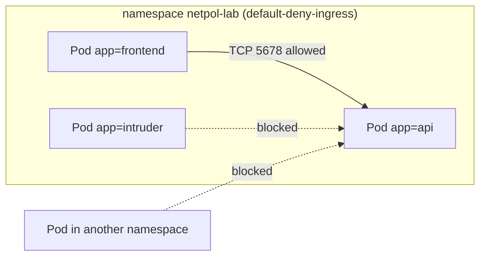

# Module 17 — NetworkPolicy (pod-to-pod firewall)

## 🎯 What you'll learn

- Why the default — **every Pod can reach every other Pod** — is a security
  problem, and how a **NetworkPolicy** fixes it.
- The **default-deny + allow-list** pattern used in real clusters.
- How policies select **who they protect** (`podSelector`) and **who's allowed
  in/out** (`from`/`to` with pod, namespace, and IP selectors).
- The two classic outages: **policies that silently don't apply** (CNI doesn't
  enforce them) and **egress deny that breaks DNS**.

## 🐳 Docker bridge

In Docker Compose you isolate services with **separate networks**: the db sits
on a `backend` network the frontend isn't on. Kubernetes has **one flat
network** — every Pod can reach every Pod across all namespaces. NetworkPolicy
is how you rebuild those walls, but with labels instead of network membership.

| | Docker Compose | Kubernetes |
|---|---------------|------------|
| Default | containers reach only networks they joined | **every Pod reaches every Pod** |
| Isolation unit | user-defined network | **NetworkPolicy** selecting Pods by label |
| "Only web may call db" | put both on one network, nothing else | `podSelector: db` + `from: podSelector: web` |
| Enforced by | Docker's bridge/iptables | the **CNI plugin** (kindnet, Calico, Cilium…) |

## 🧠 Concept

**Module 12 vs this module.** RBAC controls who can talk to the **Kubernetes
API** (`kubectl get secrets`). NetworkPolicy controls which **Pods can open
network connections** to which Pods. A compromised frontend Pod with no RBAC
rights can still `curl http://db:5432` unless a NetworkPolicy stops it.

**How a policy works.**

```yaml
spec:
  podSelector: { matchLabels: { app: api } }   # 1. WHICH pods this protects
  policyTypes: [Ingress]                        # 2. which direction(s) it restricts
  ingress:                                      # 3. the allow-list
    - from:
        - podSelector: { matchLabels: { app: frontend } }
      ports:
        - { protocol: TCP, port: 5678 }
```

The rules that matter:

1. **Pods with no policy selecting them are wide open.** The moment *any*
   policy with `Ingress` selects a Pod, that Pod becomes **deny-all inbound
   except what policies allow**. Same for `Egress`.
2. **Policies only allow; they never deny.** Multiple policies selecting the
   same Pod are **added together** (OR). There's no "deny this one source" rule
   in core NetworkPolicy.
3. **`ports` are the Pod's ports** (`targetPort` / `containerPort`), not the
   Service's `port`. Service routing happens before the policy check.
4. **Ingress and egress are separate.** For A → B to work, A's egress (if
   restricted) must allow B **and** B's ingress (if restricted) must allow A.

**Selectors inside `from` / `to`:**

| Selector | Matches |
|----------|---------|
| `podSelector` | Pods with these labels **in the policy's namespace** |
| `namespaceSelector` | **all** Pods in matching namespaces |
| `namespaceSelector` + `podSelector` in **one** list item | matching Pods **in** matching namespaces (AND) |
| two separate list items | either one (OR) — a frequent, dangerous typo |
| `ipBlock: { cidr: 10.0.0.0/8 }` | IP ranges (usually for traffic leaving the cluster) |

Every namespace carries the label `kubernetes.io/metadata.name: <name>`, which
is the easy way to select a namespace by name.

**The standard pattern.** Per namespace: one `default-deny` policy
(`podSelector: {}`), then small allow-policies per real flow
(frontend → api, api → db, everything → DNS).

**Enforcement is the CNI's job.** The API server accepts any NetworkPolicy, but
only CNIs that implement them (Calico, Cilium, kindnet in **kind ≥ v0.24**…)
enforce it. Docker Desktop's built-in cluster and old kind versions accept the
YAML and **enforce nothing**. Always test a deny before trusting it.

## 📊 Diagram



## 📋 Cheatsheet

```bash
kubectl get networkpolicy -n NS          # alias: netpol
kubectl describe netpol NAME -n NS       # human-readable allow rules

# test a flow from a throwaway pod WITH a given label (-m 3 = 3s timeout)
kubectl run t --rm -i --restart=Never -n NS --image=curlimages/curl \
  --labels=app=frontend -- -s -m 3 http://api
# timeout (exit 28) = blocked by policy; "Connection refused" = reached pod, app not listening

kubectl get ns --show-labels             # kubernetes.io/metadata.name=<ns>
```

```yaml
# default deny inbound for a whole namespace
spec: { podSelector: {}, policyTypes: [Ingress] }

# allow from pods labelled role=client in namespaces labelled team=a  (AND)
ingress:
  - from:
      - namespaceSelector: { matchLabels: { team: a } }
        podSelector:       { matchLabels: { role: client } }

# when restricting egress, always allow DNS
egress:
  - to:
      - namespaceSelector: { matchLabels: { kubernetes.io/metadata.name: kube-system } }
        podSelector:       { matchLabels: { k8s-app: kube-dns } }
    ports: [{ protocol: UDP, port: 53 }, { protocol: TCP, port: 53 }]
```

## 🧪 Practice

> Run on `kind-k8s-course`; paste output as you go.

**Step 0 — Will policies be enforced?**
```bash
kind version
```
Expected: `kind v0.24.0` or newer. Older kind → kindnet ignores
NetworkPolicy; upgrade kind and recreate the cluster
(`kind delete cluster --name k8s-course && kind create cluster --name k8s-course`)
or Step 3 will "pass" without blocking anything.

**Step 1 — Deploy the backend.**
```bash
kubectl apply -f manifests/17-network-policy/apps.yaml
kubectl rollout status deploy/api -n netpol-lab
```

**Step 2 — Baseline: everyone can reach it.**
```bash
kubectl run fe --rm -i --restart=Never -n netpol-lab --image=curlimages/curl --labels=app=frontend -- -s -m 3 http://api
kubectl run bad --rm -i --restart=Never -n netpol-lab --image=curlimages/curl --labels=app=intruder -- -s -m 3 http://api
kubectl run far --rm -i --restart=Never -n default --image=curlimages/curl -- -s -m 3 http://api.netpol-lab
```
Expected: `api says hi` three times — same namespace or not, any label. This is
the flat network.

**Step 3 — Default deny.**
```bash
kubectl apply -f manifests/17-network-policy/default-deny.yaml
kubectl run fe --rm -i --restart=Never -n netpol-lab --image=curlimages/curl --labels=app=frontend -- -s -m 3 http://api
```
Expected: no output after ~3s and `pod netpol-lab/fe terminated (Error)` —
curl timed out. Nothing can reach `api` now, not even the frontend.

**Step 4 — Allow just the frontend.**
```bash
kubectl apply -f manifests/17-network-policy/allow-frontend.yaml
kubectl describe netpol api-allow-frontend -n netpol-lab
kubectl run fe  --rm -i --restart=Never -n netpol-lab --image=curlimages/curl --labels=app=frontend -- -s -m 3 http://api
kubectl run bad --rm -i --restart=Never -n netpol-lab --image=curlimages/curl --labels=app=intruder -- -s -m 3 http://api
kubectl run far --rm -i --restart=Never -n default --image=curlimages/curl --labels=app=frontend -- -s -m 3 http://api.netpol-lab
```
Expected: `fe` → `api says hi`; `bad` → timeout; `far` → **timeout too**, even
with the right label, because a bare `podSelector` only matches Pods in the
policy's own namespace.

**Step 5 — Lock egress and see DNS break (then fix).** First a deliberately
incomplete version — deny all egress, no DNS rule:
```bash
kubectl apply -n netpol-lab -f - <<'EOF'
apiVersion: networking.k8s.io/v1
kind: NetworkPolicy
metadata: { name: deny-all-egress }
spec: { podSelector: {}, policyTypes: [Egress] }
EOF
kubectl run fe --rm -i --restart=Never -n netpol-lab --image=curlimages/curl --labels=app=frontend -- -sS -m 3 http://api
```
Expected: `Could not resolve host: api` (or `Resolving timed out`) — not even
DNS gets out. Now replace it
with the version that allows DNS + the api flow:
```bash
kubectl delete netpol deny-all-egress -n netpol-lab
kubectl apply -f manifests/17-network-policy/deny-egress-allow-dns.yaml
kubectl run fe --rm -i --restart=Never -n netpol-lab --image=curlimages/curl --labels=app=frontend -- -sS -m 3 http://api
kubectl run fe --rm -i --restart=Never -n netpol-lab --image=curlimages/curl --labels=app=frontend -- -sS -m 3 https://example.com
```
Expected: `api says hi`, then a timeout for `example.com` — DNS works, the
allowed in-cluster flow works, the internet is blocked.

**Step 6 — Clean up.**
```bash
kubectl delete namespace netpol-lab
```

## ✅ Check yourself

You should now be able to:

- [ ] Explain why Pods are reachable from everywhere by default.
- [ ] Write a default-deny policy and an allow policy for one flow.
- [ ] Explain why `ports` in a policy uses the container port.
- [ ] Allow traffic from a specific namespace, and tell AND from OR selectors.
- [ ] Explain why an egress-deny policy needs a DNS rule.
- [ ] Say how you'd confirm the cluster's CNI actually enforces policies.

**Challenge:** Deploy the capstone (`kubectl apply -k manifests/14-capstone/`)
and lock down its two back tiers: default-deny ingress in `capstone`, then allow
only backend → db (TCP 5432) and pods labelled `app=frontend` → backend (find
the container port in the manifest). Prove it: a curl Pod labelled
`app=frontend` gets the backend reply, a Pod labelled `app=intruder` times out,
and `nc -z -w 3 db 5432` from a busybox Pod labelled `app=frontend` fails. Then
`kubectl rollout restart deploy/backend -n capstone` — the new backend Pods must
still pass their `nc -z db 5432` initContainer.

## 🐛 Common gotchas

- **Policy applied but nothing is blocked** → the CNI doesn't enforce
  NetworkPolicy (Docker Desktop, kind < v0.24, flannel alone). Always test the
  deny.
- **Everything broke after adding egress rules** → you forgot DNS (UDP **and**
  TCP 53 to kube-dns).
- **Used the Service port** → `port: 80` in the policy when the container
  listens on 5678 = the allowed traffic is still dropped.
- **`namespaceSelector` and `podSelector` as two list items** → that's OR:
  "any Pod in that namespace **or** any matching Pod here". Put them in **one**
  item (no second `-`) for AND.
- **Ingress controller / monitoring stopped working** → after default-deny, the
  ingress-nginx Pods (Module 15) and Prometheus scrapers come from other
  namespaces. Add explicit allows for them.
- **Expecting a "deny" rule** → core NetworkPolicy only has allow rules.
  Calico/Cilium have their own CRDs for ordered deny rules and L7 (HTTP path)
  rules.
