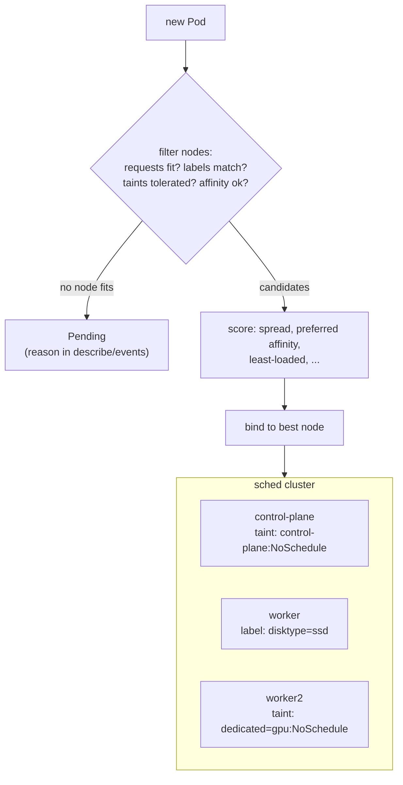

# Module 18 — Scheduling (where Pods land)

## 🎯 What you'll learn

- How the **scheduler** picks a node: **filter** (which nodes *can* run it) →
  **score** (which is *best*).
- Steering Pods **toward** nodes: `nodeSelector` and **node affinity**.
- Keeping nodes **for special work**: **taints** (on nodes) and **tolerations**
  (on Pods).
- Spreading replicas for high availability: **pod anti-affinity** and
  **topologySpreadConstraints**.
- **DaemonSets**: exactly one Pod per node.
- Reading "why is my Pod Pending?" from scheduler events.

## 🐳 Docker bridge

On a single Docker host there's nothing to decide — containers run where
`docker run` was typed. Docker Swarm added **placement constraints**
(`node.labels.disktype == ssd`) and **global services** (one container per
node). Kubernetes has the same ideas, in more detail:

| | Docker Swarm | Kubernetes |
|---|-------------|------------|
| Run only on some nodes | `--constraint node.labels.x==y` | `nodeSelector` / node affinity |
| Keep a node for special work | (drain / constraints) | **taint** the node + **toleration** on allowed Pods |
| Don't stack replicas on one node | `--placement-pref spread=…` | pod anti-affinity / topology spread |
| One per node | `--mode global` | **DaemonSet** |

## 🧠 Concept

**Filter, then score.** For every new Pod the scheduler (1) **filters** out
nodes that can't run it — not enough free CPU/memory **requests** (Module 9),
wrong labels, an untolerated taint, an anti-affinity conflict — then (2)
**scores** the rest and binds the Pod to the winner. No node survives the
filter → the Pod stays **Pending**, and `kubectl describe pod` gives the reason
per node, e.g. `0/3 nodes are available: 1 node(s) had untolerated taint…`.

**Attract: nodeSelector and node affinity.**

```yaml
nodeSelector: { disktype: ssd }          # simple: label must match exactly

affinity:
  nodeAffinity:                          # richer: In/NotIn/Exists, hard or soft
    requiredDuringSchedulingIgnoredDuringExecution:
      nodeSelectorTerms:
        - matchExpressions:
            - { key: topology.kubernetes.io/zone, operator: In, values: [eu-1a, eu-1b] }
    preferredDuringSchedulingIgnoredDuringExecution:
      - weight: 50
        preference:
          matchExpressions: [{ key: disktype, operator: In, values: [ssd] }]
```

`required…` = hard filter. `preferred…` = scoring hint only. `…IgnoredDuringExecution`
= changing node labels later doesn't evict running Pods.

**Repel: taints and tolerations.** A **taint** on a node says "keep out unless
you tolerate me". A **toleration** on a Pod lets it in — it doesn't pull it in.
Taint effects:

| Effect | New Pods without toleration | Already-running Pods |
|--------|-----------------------------|----------------------|
| `NoSchedule` | not scheduled | stay |
| `PreferNoSchedule` | avoided if possible | stay |
| `NoExecute` | not scheduled | **evicted** |

You've already met one: the control plane carries
`node-role.kubernetes.io/control-plane:NoSchedule`, which is why your app Pods
never land there in a multi-node cluster. Kubernetes also taints broken nodes
automatically (`node.kubernetes.io/not-ready:NoExecute`), which is how Pods
get moved off dead nodes.

> 🔑 **Dedicated nodes need both:** a **taint** to keep others off + a
> **toleration and a nodeSelector/affinity** on your Pods to send them there.

**Spread: anti-affinity and topology spread.** Three replicas on one node = one
node failure takes out the whole app.

- **Pod anti-affinity** (`required…`): "never on a node that already runs a Pod
  with label X". Strict; extra replicas go Pending when you run out of nodes.
- **topologySpreadConstraints**: "keep the count per node (or per zone) within
  `maxSkew`". With `whenUnsatisfiable: ScheduleAnyway` it stays a preference,
  so it's usually the better default for HA.

`topologyKey` picks the failure domain: `kubernetes.io/hostname` (node) or
`topology.kubernetes.io/zone` (zone, set by cloud providers).

**DaemonSet.** No `replicas`: it runs **one Pod on every node** that passes its
selectors and taints, and adds one automatically when a node joins. Used for
node-level agents (log shippers, node-exporter, CNI, kube-proxy). Taints apply
to DaemonSets too, so real agents add a catch-all `tolerations: [{operator: Exists}]`.

## 📊 Diagram



## 📋 Cheatsheet

```bash
# --- multi-node kind cluster for this module ---
kind create cluster --name sched --config manifests/18-scheduling/kind-multinode.yaml
kubectl config use-context kind-sched           # (kind switches automatically)

# --- see where pods are ---
kubectl get pods -o wide                         # NODE column
kubectl get nodes --show-labels
kubectl describe node NODE | grep -A3 Taints

# --- labels & taints ---
kubectl label node NODE disktype=ssd
kubectl label node NODE disktype-                # remove label
kubectl taint node NODE dedicated=gpu:NoSchedule
kubectl taint node NODE dedicated=gpu:NoSchedule-   # remove taint (trailing -)

# --- why Pending? ---
kubectl describe pod POD | sed -n '/Events/,$p'
kubectl get events --field-selector reason=FailedScheduling

# --- DaemonSets ---
kubectl get ds                                   # DESIRED = number of eligible nodes
kubectl rollout status ds/NAME
```

```yaml
nodeSelector: { disktype: ssd }
tolerations:
  - { key: dedicated, operator: Equal, value: gpu, effect: NoSchedule }
topologySpreadConstraints:
  - { maxSkew: 1, topologyKey: kubernetes.io/hostname, whenUnsatisfiable: ScheduleAnyway,
      labelSelector: { matchLabels: { app: web } } }
affinity:
  podAntiAffinity:
    requiredDuringSchedulingIgnoredDuringExecution:
      - { topologyKey: kubernetes.io/hostname, labelSelector: { matchLabels: { app: web } } }
```

## 🧪 Practice

> This module uses a **new 3-node cluster** `kind-sched`. Keep it after the
> lab — Module 19 reuses it. Paste output as you go.

**Step 1 — Create the cluster and meet the nodes.**
```bash
kind create cluster --name sched --config manifests/18-scheduling/kind-multinode.yaml
kubectl config current-context
kubectl get nodes
kubectl describe node sched-control-plane | grep Taints
```
Expected: context `kind-sched`; nodes `sched-control-plane`, `sched-worker`,
`sched-worker2`; the control plane has
`node-role.kubernetes.io/control-plane:NoSchedule`.

**Step 2 — Hard anti-affinity runs out of nodes.**
```bash
kubectl apply -f manifests/18-scheduling/anti-affinity.yaml
kubectl get pods -l app=spread -o wide
```
Expected: two `Running` Pods on **different** workers, one `Pending`. Ask why:
```bash
kubectl describe pod -l app=spread | grep -A3 "FailedScheduling"
```
Expected: something like `0/3 nodes are available: 1 node(s) had untolerated
taint {node-role.kubernetes.io/control-plane: }, 2 node(s) didn't match pod
anti-affinity rules.` Two filters in one line. Clean up:
`kubectl delete -f manifests/18-scheduling/anti-affinity.yaml`.

**Step 3 — Topology spread: even, but never stuck.**
```bash
kubectl apply -f manifests/18-scheduling/topology-spread.yaml
kubectl get pods -l app=even -o wide
```
Expected: 4 Running, **2 per worker**. Scale to 5
(`kubectl scale deploy even --replicas=5`) → all 5 run (3 + 2) because
`ScheduleAnyway` is a preference. Clean up:
`kubectl delete -f manifests/18-scheduling/topology-spread.yaml`.

**Step 4 — nodeSelector: Pending until a node matches.**
```bash
kubectl apply -f manifests/18-scheduling/node-selector.yaml
kubectl get pods -l app=needs-ssd
kubectl label node sched-worker disktype=ssd
kubectl get pods -l app=needs-ssd -o wide
```
Expected: both Pods `Pending` at first (no node has `disktype=ssd`), then
`Running` on `sched-worker` seconds after you add the label. The scheduler
retries Pending Pods when the cluster changes.

**Step 5 — Taint a node for dedicated work.**
```bash
kubectl taint node sched-worker2 dedicated=gpu:NoSchedule
kubectl label node sched-worker2 dedicated=gpu
kubectl create deployment plain --image=registry.k8s.io/pause:3.10 --replicas=4
kubectl apply -f manifests/18-scheduling/toleration.yaml
kubectl get pods -l 'app in (plain, gpu-job)' -o wide
```
Expected: all 4 `plain` Pods on **sched-worker** (worker2 is tainted, the
control plane is tainted), both `gpu-job` Pods on **sched-worker2**. Now try
the "toleration only" mistake:
```bash
kubectl patch deploy gpu-job --type=json -p '[{"op":"remove","path":"/spec/template/spec/nodeSelector"}]'
kubectl get pods -l app=gpu-job -o wide
```
Expected: new Pods may land on **either** worker — a toleration permits
worker2, it doesn't require it. Clean up:
`kubectl delete deploy plain gpu-job needs-ssd`.

**Step 6 — DaemonSet: one per node.**
```bash
kubectl apply -f manifests/18-scheduling/daemonset.yaml
kubectl get ds node-agent
kubectl get pods -l app=node-agent -o wide
kubectl logs -l app=node-agent
```
Expected: `DESIRED 3 / READY 3` — one Pod on each node including the control
plane and the tainted worker2, thanks to `operator: Exists`. Logs show
`agent on <node>` three times.

**Step 7 — Clean up (keep the cluster).**
```bash
kubectl delete -f manifests/18-scheduling/daemonset.yaml
kubectl taint node sched-worker2 dedicated=gpu:NoSchedule-
kubectl label node sched-worker2 dedicated-
kubectl label node sched-worker disktype-
```
Leave `kind-sched` running for Module 19. (To switch back to the course
cluster: `kubectl config use-context kind-k8s-course`.)

## ✅ Check yourself

You should now be able to:

- [ ] Describe filter vs score, and read a `FailedScheduling` message.
- [ ] Pin Pods to labelled nodes with `nodeSelector` / node affinity.
- [ ] Dedicate a node with taint + toleration + selector, and explain why the
      toleration alone isn't enough.
- [ ] Choose between pod anti-affinity and topology spread for HA.
- [ ] Explain what a DaemonSet is for and why it needs tolerations.

**Challenge:** Without the cheatsheet: remove `tolerations` from
`daemonset.yaml`, **predict** `DESIRED` before applying, then check. Then taint
`sched-worker` with `maintenance=true:NoExecute` while a 4-replica Deployment
is running on the workers — predict which Pods are evicted and where their
replacements land. Remove the taint afterwards.

## 🐛 Common gotchas

- **Pending with "Insufficient cpu"** → the scheduler adds up **requests**, not
  real usage. Lower requests or add nodes (Module 9).
- **Pending with "didn't match Pod's node affinity/selector"** → label typo, or
  no node carries it yet. `kubectl get nodes --show-labels`.
- **Toleration added, Pod still lands elsewhere** → tolerations allow, they
  don't attract. Add `nodeSelector`/affinity too.
- **DaemonSet DESIRED is lower than your node count** → some nodes are tainted
  (control plane, dedicated pools). Add tolerations if the agent must run there.
- **Hard anti-affinity blocks a rollout** → with N nodes and N replicas, the
  rolling update's surge Pod has nowhere to go. Use topology spread with
  `ScheduleAnyway`, or `maxSurge: 0`.
- **Removing a taint** → the trailing `-` is required:
  `kubectl taint node N key=value:Effect-`.
- **Wrong cluster** → `kind create` switches your context to `kind-sched`.
  Check `kubectl config current-context` before running other modules.
