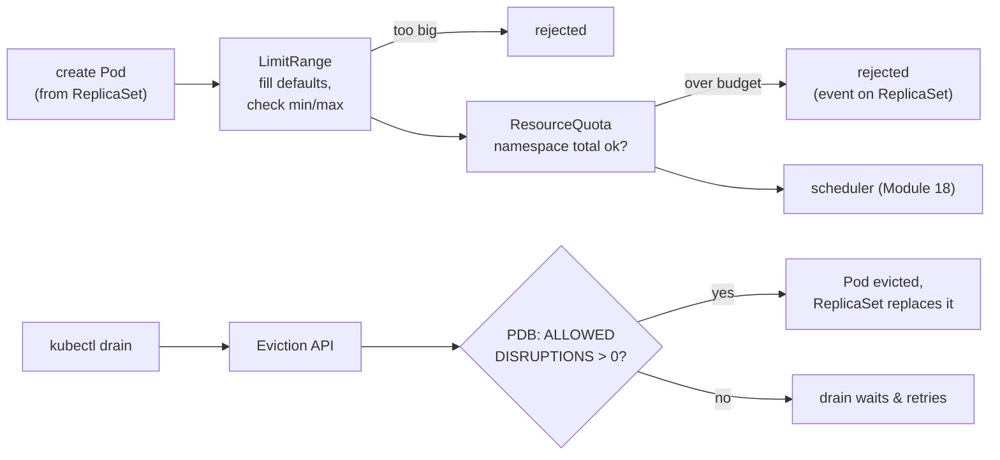

# Module 19 — Namespace guardrails (ResourceQuota, LimitRange, PodDisruptionBudget)

## 🎯 What you'll learn

- How a shared cluster stops one team from using everything: **ResourceQuota**
  (a namespace budget).
- How to give every container sane **default requests/limits** and a **max**:
  **LimitRange**.
- How to keep an app up while nodes are **drained** for upgrades:
  **PodDisruptionBudget (PDB)**.
- What happens at **admission**: why a Pod can be rejected before it exists,
  and where that error shows up.

## 🐳 Docker bridge

On your own Docker host nobody else is competing for the machine, and when you
reboot it you know what goes down. A company cluster is shared by many teams and
its nodes get drained and replaced all the time. These three objects are the
cluster admin's tools for that:

| Need | Docker-ish equivalent | Kubernetes |
|------|----------------------|------------|
| Cap a team's total usage | separate VMs/hosts per team | **ResourceQuota** per namespace |
| Sensible defaults if a container sets none | `--cpus`/`--memory` in every compose file | **LimitRange** defaults |
| Refuse giant containers | code review | **LimitRange** `max` |
| "Don't take down all my replicas during maintenance" | rolling host reboots by hand | **PodDisruptionBudget** |

## 🧠 Concept

**Admission happens before scheduling.** When you create a Pod, the API server
runs **admission controllers**: LimitRange first **fills defaults** and checks
min/max, then ResourceQuota checks the namespace **total**. Fail → the request
is **rejected**; the Pod never exists. With a Deployment you don't see the
error on `kubectl apply` (the Deployment is fine) — the **ReplicaSet** fails to
create Pods, so you find it in `kubectl describe rs` or events.

**ResourceQuota — the namespace budget.**

```yaml
spec:
  hard:
    pods: "6"
    requests.cpu: "1"        # sum of all pods' CPU requests
    limits.memory: 2Gi       # sum of all pods' memory limits
    services.nodeports: "0"  # object counts work too
```

`kubectl describe quota` shows **Used vs Hard**. Key rule: once a namespace has
a quota on `requests.cpu` (etc.), **every new Pod must declare it**, or it's
rejected with `must specify requests.cpu`. That's why quotas and LimitRanges
come as a pair.

**LimitRange — per-container defaults and caps.**

| Field | Effect |
|-------|--------|
| `defaultRequest` | request injected if the container sets none |
| `default` | limit injected if the container sets none |
| `max` / `min` | reject containers asking for more / less |

Defaults are written into the Pod at creation — existing Pods aren't changed.

**PodDisruptionBudget — survive maintenance.** **Voluntary disruptions** are
evictions someone chose to do: `kubectl drain`, a node pool upgrade, the
cluster autoscaler removing a node. Drain uses the **Eviction API**, which
checks PDBs: if evicting a Pod would drop the matching ready Pods below
`minAvailable` (or above `maxUnavailable`), the eviction is **refused** and
drain waits and retries.

```yaml
spec:
  minAvailable: 2            # or: maxUnavailable: 1   (pick one)
  selector: { matchLabels: { app: web } }
```

`kubectl get pdb` → **ALLOWED DISRUPTIONS** = how many Pods may be evicted right
now. PDBs do **not** protect against **involuntary** disruptions (node crash,
OOM kill) — only replicas spread across nodes (Module 18) help there. Also
`kubectl delete pod` bypasses PDBs; only evictions honour them.

> 🔑 A PDB with `minAvailable` equal to `replicas` (or `maxUnavailable: 0`)
> means **ALLOWED 0** → node drains hang forever. Platform teams hate this one.

## 📊 Diagram



## 📋 Cheatsheet

```bash
# --- quota ---
kubectl describe quota -n NS                 # Used vs Hard
kubectl get resourcequota -A

# --- limit range ---
kubectl describe limitrange -n NS
kubectl get pod POD -n NS -o jsonpath='{.spec.containers[0].resources}'   # injected defaults

# --- find admission rejections ---
kubectl describe rs -n NS -l app=web | grep -A5 Events
kubectl get events -n NS --field-selector reason=FailedCreate

# --- disruption budgets & drains ---
kubectl get pdb -n NS                        # MIN AVAILABLE, ALLOWED DISRUPTIONS
kubectl drain NODE --ignore-daemonsets --delete-emptydir-data [--timeout=60s]
kubectl uncordon NODE                        # allow scheduling again
kubectl cordon NODE                          # stop new pods, don't evict
```

## 🧪 Practice

> Run on the **`kind-sched`** cluster from Module 18 (drains need more than one
> worker). If you deleted it:
> `kind create cluster --name sched --config manifests/18-scheduling/kind-multinode.yaml`.

**Step 1 — Create the namespace with guardrails.**
```bash
kubectl config use-context kind-sched
kubectl apply -f manifests/19-guardrails/namespace.yaml
kubectl apply -f manifests/19-guardrails/quota.yaml -f manifests/19-guardrails/limitrange.yaml
kubectl describe quota -n team-a
```
Expected: every line shows `Used 0`, plus the Hard values.

**Step 2 — Defaults get injected.**
```bash
kubectl apply -f manifests/19-guardrails/deployment.yaml
kubectl rollout status deploy/web -n team-a
kubectl get pod -n team-a -l app=web -o jsonpath='{.items[0].spec.containers[0].resources}'; echo
kubectl describe quota -n team-a
```
Expected: `{"limits":{"cpu":"200m","memory":"128Mi"},"requests":{"cpu":"100m","memory":"64Mi"}}`
even though the manifest declares none. Quota now shows `pods 3/6`,
`requests.cpu 300m/1`.

**Step 3 — Hit the quota.**
```bash
kubectl scale deploy web -n team-a --replicas=10
kubectl get deploy web -n team-a
kubectl get events -n team-a --field-selector reason=FailedCreate | tail -3
```
Expected: the Deployment stops at `6/10`; events say `exceeded quota:
team-a-quota, requested: pods=1, used: pods=6, limited: pods=6`. Note
`kubectl scale` itself **succeeded** — the failure is on the ReplicaSet.
Scale back: `kubectl scale deploy web -n team-a --replicas=3`.

**Step 4 — Hit the LimitRange max and the object quota.**
```bash
kubectl apply -f manifests/19-guardrails/too-big.yaml
kubectl expose deploy web -n team-a --type=NodePort --port=80
```
Expected: both **rejected immediately** — `maximum cpu usage per Container is
500m, but limit is 1`, and `exceeded quota: team-a-quota, requested:
services.nodeports=1`. Bare Pods and Services fail at `kubectl` time because
you're creating them directly.

**Step 5 — A PDB lets a drain through, one Pod at a time.**
```bash
kubectl apply -f manifests/19-guardrails/pdb.yaml
kubectl get pdb -n team-a
kubectl get pods -n team-a -o wide
kubectl drain sched-worker --ignore-daemonsets --delete-emptydir-data
kubectl get pods -n team-a -o wide
kubectl uncordon sched-worker
```
Expected: `MIN AVAILABLE 2, ALLOWED DISRUPTIONS 1`. Drain evicts the `web`
Pods on `sched-worker` (you may see `error when evicting … will retry` while
it waits for a replacement to become Ready), then `node/sched-worker drained`.
Afterwards all 3 `web` Pods are on `sched-worker2`.

**Step 6 — A too-strict PDB blocks the drain.**
```bash
kubectl patch pdb web-pdb -n team-a -p '{"spec":{"minAvailable":3}}'
kubectl get pdb -n team-a
kubectl drain sched-worker2 --ignore-daemonsets --delete-emptydir-data --timeout=30s
```
Expected: `ALLOWED DISRUPTIONS 0`, then repeated `Cannot evict pod as it would
violate the pod's disruption budget`, and the drain gives up after 30s. This is
the "node upgrade stuck for hours" ticket. Fix it and finish:
```bash
kubectl patch pdb web-pdb -n team-a -p '{"spec":{"minAvailable":2}}'
kubectl drain sched-worker2 --ignore-daemonsets --delete-emptydir-data
kubectl uncordon sched-worker2
kubectl get pods -n team-a -o wide
```

**Step 7 — Clean up.**
```bash
kubectl delete namespace team-a
kind delete cluster --name sched
kubectl config use-context kind-k8s-course
```

## ✅ Check yourself

You should now be able to:

- [ ] Explain the difference between a ResourceQuota and a LimitRange.
- [ ] Explain why a quota on `requests.cpu` forces every Pod to declare requests.
- [ ] Find why a Deployment is stuck below its replica count (ReplicaSet events).
- [ ] Write a PDB and read ALLOWED DISRUPTIONS.
- [ ] Say which disruptions a PDB protects against and which it doesn't.
- [ ] Spot a PDB that will block every drain.

**Challenge:** Without the cheatsheet: in a fresh namespace `team-b`, write a
quota allowing at most **2 Deployments** and **512Mi** total memory requests,
plus a LimitRange defaulting memory requests to `200Mi`. Predict how many
replicas of a resource-less nginx Deployment will actually run if you ask for
4, then verify. (Hint: object counts use the form `count/deployments.apps`.)

## 🐛 Common gotchas

- **Deployment stuck at N/M, no Pods failing** → admission rejections live on
  the **ReplicaSet**, not the Deployment or Pods. `kubectl describe rs`.
- **`must specify requests.cpu`** → the namespace has a quota on it and no
  LimitRange default. Add `resources` or a LimitRange.
- **LimitRange added, old Pods unchanged** → defaults apply only at creation.
  `kubectl rollout restart` to pick them up.
- **Drain hangs forever** → a PDB with ALLOWED 0 (`minAvailable == replicas`,
  or a single-replica app with `minAvailable: 1`). Scale up or relax the PDB.
- **Drain refuses to start** → DaemonSet Pods or `emptyDir` data. Add
  `--ignore-daemonsets --delete-emptydir-data` (emptyDir data is lost).
- **Forgot `uncordon`** → the node stays `SchedulingDisabled`; new Pods avoid
  it. `kubectl get nodes` shows the status.
- **Expecting a PDB to survive a crash** → PDBs only gate voluntary evictions.
  Spread replicas across nodes/zones for real failures.
