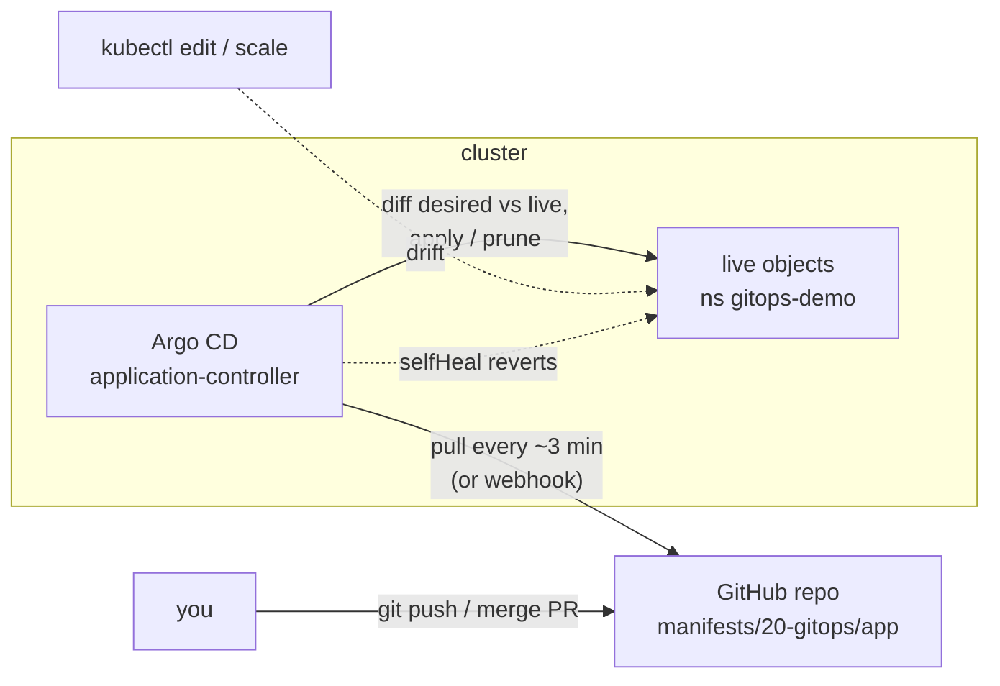

# Module 20 — GitOps with Argo CD

## 🎯 What you'll learn

- The **GitOps** model: git is the **source of truth**, and an agent in the
  cluster **pulls** and applies it — instead of people (or CI) running
  `kubectl apply`.
- Install **Argo CD** and describe an app with an **Application** object.
- **Sync** and **Health** status, **auto-sync**, **self-heal** (undo drift), and
  **prune** (delete what left git).
- Deploy and roll back **by git commit** — `git revert` is the rollback button.

## 🐳 Docker bridge

Without GitOps, deploying looks like SSH-ing to a host and running
`docker compose pull && docker compose up -d` — by hand or from a CI job that
holds production credentials. Nobody can say for sure that what's running
matches the repo, because anyone could have changed it. GitOps flips it around:
a process **on the host** watches the repo and runs `up -d` whenever git
changes, and also when someone changes the host by hand.

| | Push-style (kubectl / CI) | GitOps (Argo CD / Flux) |
|---|---------------------------|-------------------------|
| Who applies changes | a person or CI job | an agent **inside** the cluster |
| Cluster credentials | handed to CI / laptops | stay in the cluster |
| Manual `kubectl edit` | sticks until someone notices | **reverted** (self-heal) |
| What's running? | check the cluster | read the repo |
| Rollback | `rollout undo` / re-run old pipeline | `git revert` |
| Audit trail | CI logs, if any | git history |

## 🧠 Concept

**The loop.** Argo CD runs a controller that, for each **Application**, keeps
comparing two things:

- **desired state** — the manifests rendered from a git repo / path / revision
  (plain YAML, a Kustomize dir, or a Helm chart: Modules 14 and 16), and
- **live state** — what's actually in the cluster.

It's the same reconcile loop as a Deployment controller (Module 1), one level
up: **spec = git**.

**Two statuses — they mean different things:**

| Status | Question | Values |
|--------|----------|--------|
| **Sync** | does live match git? | `Synced` / `OutOfSync` |
| **Health** | is what's running actually working? | `Healthy` / `Progressing` / `Degraded` / `Missing` |

`Synced` + `Degraded` = git was applied exactly, and the app it describes is
broken (e.g. a bad image tag). That's a git problem, not an Argo problem.

**The Application object.**

```yaml
spec:
  source:      { repoURL: https://github.com/you/repo.git, targetRevision: main, path: manifests/app }
  destination: { server: https://kubernetes.default.svc, namespace: my-app }
  syncPolicy:
    automated:
      prune: true      # object removed from git -> deleted from cluster
      selfHeal: true   # live object edited by hand -> changed back
```

Without `automated`, Argo only **reports** OutOfSync and you click/run Sync.
Many teams auto-sync dev and keep production manual.

**How changes arrive.** Argo checks the repo every **~3 minutes** by default
(webhooks from GitHub make it instant). "Refresh" in the UI forces a check now.

**What changes for you day to day:**
- You deploy by **merging a PR**. Code review becomes change review.
- CI's job shrinks to *build and push the image, then commit the new tag*. CI
  no longer needs cluster credentials.
- `kubectl edit` in production stops "working" (that's the point). Debug with
  kubectl freely; **change** through git.

**Argo CD vs Flux.** Both are CNCF-graduated GitOps tools with the same model.
Argo CD has a web UI and the `Application` CRD; Flux is CLI/CRD-only
(`GitRepository` + `Kustomization`). Learn one and the other is familiar.

## 📊 Diagram



## 📋 Cheatsheet

```bash
# --- install Argo CD ---
kubectl create namespace argocd
kubectl apply -n argocd --server-side --force-conflicts \
  -f https://raw.githubusercontent.com/argoproj/argo-cd/stable/manifests/install.yaml
kubectl wait -n argocd --for=condition=available deploy --all --timeout=300s

# --- UI (user: admin) ---
kubectl -n argocd get secret argocd-initial-admin-secret -o jsonpath='{.data.password}' | base64 -d; echo
kubectl port-forward -n argocd svc/argocd-server 8443:443     # https://localhost:8443

# --- applications ---
kubectl apply -f application.yaml
kubectl get applications -n argocd               # SYNC STATUS, HEALTH STATUS
kubectl describe application NAME -n argocd      # conditions, sync result, errors
kubectl -n argocd annotate application NAME argocd.argoproj.io/refresh=normal --overwrite   # check git now

# --- deploy / roll back = git ---
git commit -am "bump" && git push
git revert HEAD && git push
```

## 🧪 Practice

> Run on `kind-k8s-course`. The Application points at
> `https://github.com/NgTuanLoc/k8s.git`, so this module's files must be
> **pushed to GitHub** before Step 3 — Argo reads GitHub, not your laptop.

**Step 0 — Push the course repo.**
```bash
git add -A && git commit -m "feat: add modules 15-20" && git push
```
Check that `manifests/20-gitops/app/` appears on GitHub.

**Step 1 — Install Argo CD.**
```bash
kubectl config use-context kind-k8s-course
kubectl create namespace argocd
kubectl apply -n argocd --server-side --force-conflicts -f https://raw.githubusercontent.com/argoproj/argo-cd/stable/manifests/install.yaml
kubectl wait -n argocd --for=condition=available deploy --all --timeout=300s
kubectl get pods -n argocd
```
Expected: `condition met` for each Deployment, and ~7 Pods Running
(`argocd-server`, `argocd-repo-server`, `argocd-application-controller-0`, …).

**Step 2 — Open the UI.**
```bash
kubectl -n argocd get secret argocd-initial-admin-secret -o jsonpath='{.data.password}' | base64 -d; echo
kubectl port-forward -n argocd svc/argocd-server 8443:443
```
Browse https://localhost:8443 (accept the self-signed cert), log in as `admin`
with that password. No apps yet. Keep this terminal open.

**Step 3 — Hand the app to Argo.** In another terminal:
```bash
kubectl get ns gitops-demo
kubectl apply -f manifests/20-gitops/application.yaml
kubectl get applications -n argocd -w
```
Expected: `gitops-demo` doesn't exist at first. Within ~30s the app shows
`Synced  Healthy` (Ctrl+C the watch). You never ran `kubectl apply` on the
Deployment — Argo created the namespace, Deployment, and Service from git. In
the UI, click the app to see the tree: Application → Service / Deployment →
ReplicaSet → Pods.
```bash
kubectl run t --rm -i --restart=Never -n gitops-demo --image=curlimages/curl -- -s http://hello
```
Expected: `hello from git v1`.

**Step 4 — Drift gets healed.**
```bash
kubectl scale deploy hello -n gitops-demo --replicas=5
kubectl get deploy hello -n gitops-demo -w
```
Expected: replicas jump to 5 and then drop back to **2** within seconds.
Self-heal undid the manual change because git says 2. Ctrl+C.

**Step 5 — Deploy by commit.** Edit `manifests/20-gitops/app/deployment.yaml`:
set `replicas: 3` and `-text=hello from git v2`. Then:
```bash
git commit -am "gitops: hello v2" && git push
kubectl -n argocd annotate application gitops-demo argocd.argoproj.io/refresh=normal --overwrite
kubectl get applications -n argocd
kubectl rollout status deploy/hello -n gitops-demo
kubectl run t --rm -i --restart=Never -n gitops-demo --image=curlimages/curl -- -s http://hello
```
Expected: the app goes `OutOfSync` → `Synced`, a rolling update runs, 3 Pods,
and `hello from git v2`. (Skip the annotate and Argo still catches it within
~3 minutes.) The UI's **History** shows the commit SHA that was deployed.

**Step 6 — Roll back by revert.**
```bash
git revert --no-edit HEAD && git push
kubectl -n argocd annotate application gitops-demo argocd.argoproj.io/refresh=normal --overwrite
kubectl rollout status deploy/hello -n gitops-demo
kubectl run t --rm -i --restart=Never -n gitops-demo --image=curlimages/curl -- -s http://hello
```
Expected: back to 2 replicas and `hello from git v1`. The rollback is itself a
reviewed, audited commit.

**Step 7 — Synced but broken.** Set the image to `hashicorp/http-echo:nope`,
commit, push, refresh:
```bash
kubectl get applications -n argocd
kubectl get pods -n gitops-demo
```
Expected: `Synced` + `Progressing`, then `Degraded` (after the Deployment's
progress deadline, ~10 min). New Pods sit in `ImagePullBackOff`, and the old
ones keep serving. Argo did its job; git is wrong. Fix it the GitOps way:
`git revert --no-edit HEAD && git push`.

**Step 8 — Clean up.** Stop the port-forward, then:
```bash
kubectl delete -f manifests/20-gitops/application.yaml
kubectl get ns gitops-demo
kubectl delete namespace argocd
```
Expected: deleting the Application also removes the Deployment and Service
(the finalizer). The `gitops-demo` namespace itself may remain;
`kubectl delete ns gitops-demo` if so.

## ✅ Check yourself

You should now be able to:

- [ ] Explain push-style vs GitOps deployment and why credentials matter.
- [ ] Read an Application's Sync and Health status and say what each means.
- [ ] Explain what `selfHeal` and `prune` do.
- [ ] Deploy a change and roll it back using only git.
- [ ] Explain why `kubectl edit` in a GitOps cluster doesn't stick.

**Challenge:** Without the cheatsheet: write a second Application,
`capstone`, that deploys `manifests/14-capstone` (Argo detects the
`kustomization.yaml` on its own) **without** `automated` sync. Apply it,
confirm it shows `OutOfSync`, sync it from the UI, then delete
`hpa.yaml` from the kustomization in git and push. Predict what Argo shows,
then enable `prune` and watch the HPA disappear.

## 🐛 Common gotchas

- **`ComparisonError` / repository not found** → the repo is private, the URL
  is wrong, or the path/branch isn't pushed yet. Argo reads the remote, not your
  working copy.
- **`metadata.annotations: Too long` on install** → plain client-side apply of
  Argo's large CRDs. Use `--server-side --force-conflicts`.
- **Changes take minutes to appear** → default polling (~3 min). Refresh in the
  UI / with the annotation, or add a GitHub webhook.
- **Synced but Degraded** → the YAML in git is broken (bad image, failing
  probes). Debug with Module 10 tools, fix in git.
- **Your manual fix keeps disappearing** → self-heal is working. Commit the fix.
- **Two tools managing the same objects** → e.g. Argo and `helm upgrade` / a CI
  `kubectl apply` fighting over a Deployment. Exactly one owner per object.
- **Deleting the Application left resources behind** → no
  `resources-finalizer.argocd.argoproj.io` finalizer; the objects stay as
  orphans. Delete them by hand, or add the finalizer.
- **Secrets in git** → never commit plain Secrets (base64 isn't encryption,
  Module 6). Use Sealed Secrets, SOPS, or External Secrets Operator.
